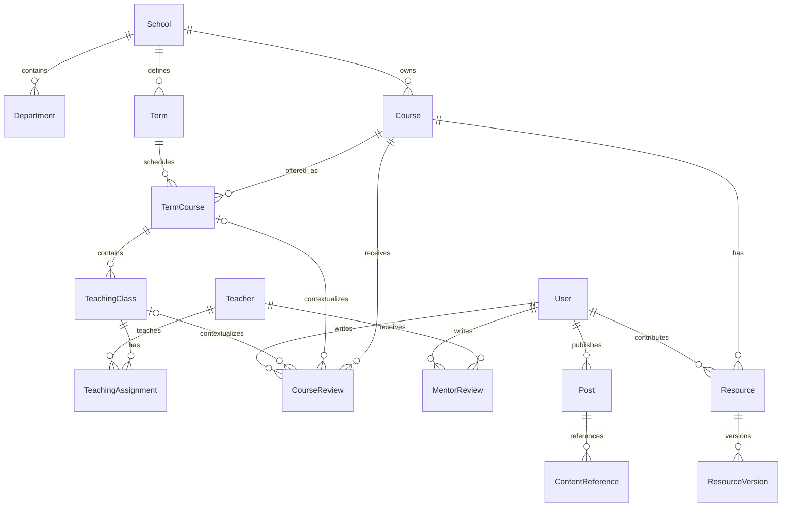

# 课程、教师与内容关系

## 目标与范围

学生需要从一门课程找到历次开课、授课教师、评价和资料，也需要从教师反查开课列表。社交内容可以引用这些对象。目标行为见[课程与评价](../spec/academic-content.md)、[资料共享](../spec/resource-sharing.md)和[社交提案](../spec/social-content.md)。本文保留内容概念，具体实现机制由平台架构后续讨论。

## 核心概念与关联

`Course` 是学校内可长期识别的课程。`TermCourse` 是这门课程在某学期的开课，即 `Course + Term`，同一课程与学期组合只对应一个对象。`TeachingClass` 表示该学期开课下的教学班，各班通过 `TeachingAssignment` 关联教师，支持合授和同一教师跨学期授课。

这张图表达业务概念之间的关联，不代表已经建立数据库或实现跨模块调用。课程评价、导师评价、资料及社交引用保留各自的用途。图中的 Post 和 ContentReference 为已延期社交模块的参考，本轮不实现。

同一课程在秋季开设两个教学班时，catalog 建立一个 `TermCourse` 和两个 `TeachingClass`，分别保存任课教师。合授通过多条授课关系表达，下一学期建立新的开课记录。

课程页汇总课程评价，学期开课页展示各班与任课关系。评价绑定课程和教师选择，并保存本人选课证据的快照。教学班为导入和来源核对提供上下文。

教师页展示授课记录、归属该教师的评价统计和导师评论。课程或教学班信息缺失时保留未知值，已经发布的评价继续使用发布时的归属依据。

## 内容发现与发布流程

用户按学校、院系、学期和教师查找课程，从课程进入开课、评价和资料，也能从教师查看其开课列表。缺失的课程信息保持未提供，避免用户把未知学分或年份理解为真实数值。

评课提供预览与全文阅读。课程评价的初始资格包括有效校园资格、手机号和本人选课记录，教师选项来自本人任课记录。评价绑定课程与明确的教师选择，教学班保留为教务来源对象。课程评价使用五个维度的文字和表情评分，导师评论提供可自由编辑的推荐模板。回复、投票、课程收藏和草稿帮助用户参与讨论。

资料上传只要求用户判断原创或转载，转载填写自由文本来源或选择来源未知。作品授权、资料是否公开、用户是否有下载权是不同问题：拥有平台作品许可，不等于每个用户都可下载；用户购买下载权，也不意味着取得对外商业使用权。

## 关联入口

[我的课程与课表](../spec/my-courses.md)可以进入对应课程和教师；[个人中心](../spec/personal-center.md)集中本人评课、课程收藏、草稿与上传资料；[通知中心](../spec/notifications.md)反馈回复、内容管理和申请结果。社交引用目标不可用时，向用户说明当前状态，不展示看似仍可访问的内容卡片。

## 取舍与待确认事项

教师档案独立于登录账号，可以先录入教师及开课信息。课程评价采用五个评分维度，导师评论使用六段可编辑的推荐模板。教师评分由归属该教师的课程评价汇总。

评价默认匿名，作者可以使用平台昵称和头像署名。用户可以评价课程、针对不同教师发表或补充评价，发布数量与奖励次数分别管理。

首次发布五分钟内支持删除和撤回重编。撤回草稿保留 24 小时，根评价删除或草稿到期时清除整条讨论，外部入口立即隐藏。完整行为由[评价规格](../spec/academic-content.md)维护。

社交模块已经明确延期，QQ 群管理继续保留，站内群聊不进入当前交付。全部业务范围及其确认边界见[重构定位](business-scope.md)。
