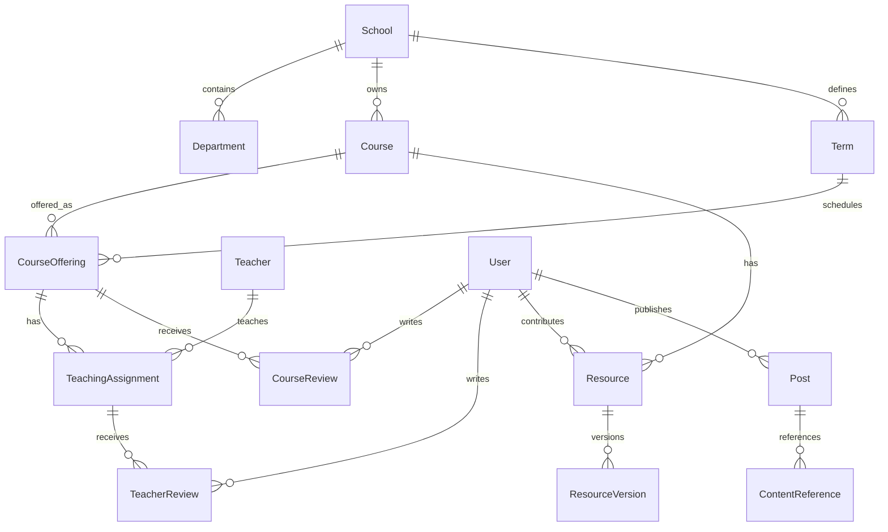

# 课程与社交内容模型

## 目标与范围

学生需要从一门课程找到历次开课、授课教师、评价和资料，也需要从教师反查开课列表。社交内容应能引用这些对象，并在原内容变化时保持正确的可见性。目标行为见[课程与资料规格](../spec/academic-content.md)和[社交规格](../spec/social-content.md)。

## 核心概念与关联

`Course` 是学校内可长期识别的课程；`CourseOffering` 是某学期某个教学班的实际开课。教师与开课通过 `TeachingAssignment` 多对多关联，从而支持合授、多个教学班和同一教师跨学期授课。

这张图表达领域关联，不要求通过跨模块 SQL 外键或联表来实现。学校、院系和学期由 campus 拥有；catalog 管理课程、开课和授课关系，reviews 管理评价，resources 管理资料，social 管理动态及引用。

例如同一门课程在秋季开设两个教学班，分别由不同教师授课：课程页聚合两个班的评价，开课页保留各自上下文，教师页按授课关系展示自己的班级。合授增加授课关系，不复制课程；跨学期新建开课对象，历史评价仍关联原开课。

## 内容发现与发布流程

客户端通过 API 聚合得到课程或教师详情。catalog 提供基础对象，reviews 与 resources 提供各自可见的内容与计数；搜索索引与统计是可重建投影。页面组合层负责批量读取和展示，不在客户端复制授权或评分规则。

评价与资料由所属模块受理，审核模块给出决策，所属模块完成发布状态变更并写事件。资料文件先进入 media 隔离区，扫描与业务审核通过后才建立可下载引用；孤儿对象由有界清理任务处理。

动态中的内容卡片保存稳定目标引用和必要展示快照。读取时再次向目标模块核对可见性；目标已限制或删除时只保留占位信息，不继续披露旧快照。评论通过受控目标类型注册，不接受任意表名或查询片段。

## 失败与恢复

发布、审核和投影分别记录状态，重复通知不能生成重复内容。索引或通知失败保留已提交的业务事实，通过 outbox 重试；撤权与下架在读路径生效，不等待索引同步。导入历史资料无法确定学期、开课或教师时保留明确的未知状态和来源证据。

## 取舍与待确认事项

教师档案与登录账号分离，避免要求教师注册后才可建立开课关系。课程评价与教师评价按不同维度统计，保留样本量与时间范围。实名/匿名、资格门槛、编辑期限、评价唯一性和具体评分维度仍需产品确认，详见规格的待确认项。

社交首期建议使用按时间排序的信息流；私信、群聊、复杂推荐后置。模块之间使用稳定引用可减少重复数据，但要承担目标不可用时的可见性判断与投影延迟，验收见相关规格。
