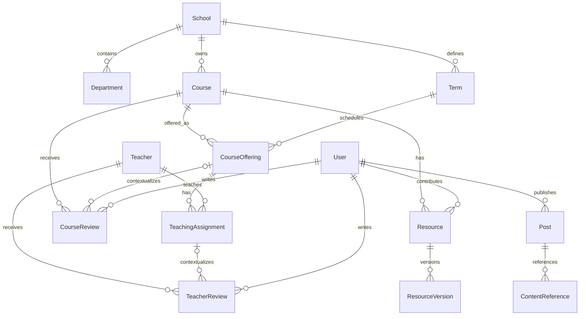

# 课程、教师与内容关系

## 目标与范围

学生需要从一门课程找到历次开课、授课教师、评价和资料，也需要从教师反查开课列表。社交内容可以引用这些对象。目标行为见[课程与评价](../spec/academic-content.md)、[资料共享](../spec/resource-sharing.md)和[社交提案](../spec/social-content.md)。本文保留内容概念，具体实现机制由平台架构后续讨论。

## 核心概念与关联

`Course` 是学校内可长期识别的课程；`CourseOffering` 是某学期某个教学班的实际开课。教师与开课通过 `TeachingAssignment` 多对多关联，从而支持合授、多个教学班和同一教师跨学期授课。

这张图表达业务概念之间的关联，不代表已经建立数据库或实现跨模块调用。课程评价、教师评价、资料及社交引用保留各自的用途。

例如同一门课程在秋季开设两个教学班，分别由不同教师授课：课程页聚合两个班的评价，开课页保留各自上下文，教师页按授课关系展示自己的班级。合授增加授课关系，不复制课程；跨学期新建开课对象，历史评价仍关联原开课。

## 内容发现与发布流程

用户按学校、院系、学期和教师查找课程，从课程进入开课、评价和资料，也能从教师查看其开课列表。缺失的课程信息保持未提供，避免用户把未知学分或年份理解为真实数值。

评课提供预览和全文两种阅读体验，学生认证与手机号决定已确认的发布门槛；具体规则集中在课程规格。课程评价使用五个维度的文字和表情评分，导师评论提供可自由编辑的推荐模板。回复、投票、课程收藏和草稿帮助用户参与讨论。

资料上传只要求用户判断原创或转载，转载填写自由文本来源或选择来源未知。作品授权、资料是否公开、用户是否有下载权是不同问题：拥有平台作品许可，不等于每个用户都可下载；用户购买下载权，也不意味着取得对外商业使用权。

## 关联入口

[我的课程与课表](../spec/my-courses.md)可以进入对应课程和教师；[个人中心](../spec/personal-center.md)集中本人评课、课程收藏、草稿与上传资料；[通知中心](../spec/notifications.md)反馈回复、内容管理和申请结果。社交引用目标不可用时，向用户说明当前状态，不展示看似仍可访问的内容卡片。

## 取舍与待确认事项

教师档案独立于登录账号，因此可以先录入教师及开课信息。课程评价与教师评价分别记录和统计，两者默认匿名，也允许作者用平台昵称和头像署名。用户可单独评价课程，也可针对不同教师分别发表，不设置每人每课或每教师的评价条数上限。课程评价、导师评论和回复支持发布后短时间内撤回重编，初始为 5 分钟且后台可配置。超时修改和删除由管理员处理。课程采用五个评分维度，导师评论使用六段可选正文模板。

社交首期建议仍待审阅，不能因已保留 QQ 群管理就推定 Next 同时实现站内群聊。全部业务范围及其确认边界见[重构定位](business-scope.md)。
