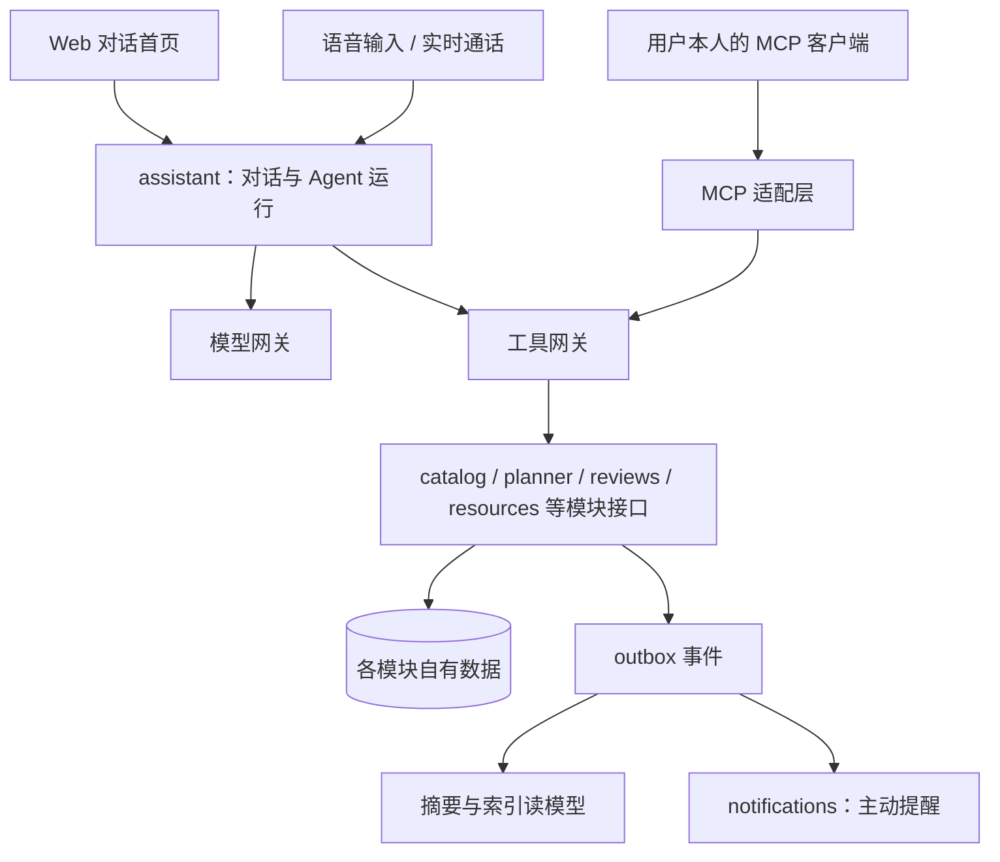

# AI native 架构

## 目标与范围

通过内容准入的用户打开首页后，可以直接用文字或语音提问和安排事项。站内 Agent 和用户本人的 MCP 客户端使用同一套工具，业务规则仍由各模块执行。行为规则见 [Agent 助手规格](../spec/agent-assistant.md)和[个人日程规格](../spec/personal-planner.md)。

管理后台的审核和批量操作继续使用表格界面。Agent 不向学校系统执行选课、退课或改成绩。

## 核心概念

| 概念 | 含义 |
| --- | --- |
| Agent | 理解用户意图、选择工具并组织回答的程序，不作业务判断 |
| 工具 | 模块声明的、可由 Agent 调用的业务能力 |
| 工具网关 | 校验工具调用、用户授权和模块状态，再调用模块公开接口的组件 |
| Agent 授权 | 用户允许某个客户端读写某类本人数据的记录 |
| MCP | 让外部 AI 客户端发现和调用工具的开放协议 |

例如，用户问“周三下午有没有空”时，Agent 调用 planner 的 `find_free_time`。planner 计算空闲时段，Agent 只负责转述结果。

## 系统边界与核心方案

**工具声明：** 模块在 OpenAPI 操作上使用 `x-agent-tool`，声明工具说明、读取和写入的全部数据类别、内容准入要求和确认要求。组合工具也要声明间接读取的数据。工具面向任务设计，不要求每个接口都对应一个工具。工具列表按已启用能力动态生成，模块关闭后工具随之消失。

**授权上下文：** 现有模块的 `Principal` 表示账号身份，继续用于业务授权。platform 增加委托信息，记录客户端、Agent 授权 ID、渠道和会话，通过请求上下文传递给审计。这样无需改写现有 Service 的权限判断。

**权限判断：** 工具网关依次检查模块状态、内容准入和 Agent 授权，模块 Service 再按用户身份检查业务权限。结果取交集，所以 Agent 授权不会扩大权限。工具不接受目标用户参数，用户身份只来自已验证的令牌。

**上下文校验：** 工具结果及其摘要都记录来源、数据类别、授权依据和是否含不可信内容。每次把历史内容发给模型前，assistant 重新检查授权和内容状态，未通过的内容不再发送。

**模型网关：** assistant 通过网关调用模型和语音服务，并记录用量和额度。供应商可替换，业务模块不直接依赖模型。

## 模块与数据归属

| 模块 | 负责内容 | 不负责内容 |
| --- | --- | --- |
| assistant | 会话、消息、运行记录、工具调用记录、待确认操作、Agent 授权、长期记忆、用量 | 课表、DDL 和评价事实 |
| planner | 个人日程、DDL、重复规则、个人课表更正、空闲时间计算 | 可信选课记录 |
| catalog | 课程、教师、校历、节次、结构化上课时间、可信选课记录 | 个人日程 |
| reviews | 评价、教师比较接口、评价摘要读模型 | Agent 授权 |

catalog 现有 `TimeText` 是自由文本，无法计算某天的课程。catalog 需要增加校历、节次和结构化时间，并保留原文。来源无法解析时标记时间未知，不猜测。

评价摘要和向量索引是可重建的读模型，记录来源评价 ID 和修订号。评价撤回、删除或下架后，摘要和索引通过事件失效。返回结果前仍要检查当前权限和内容状态。

## 业务流程与失败恢复

**写操作：** 模型提出操作后，assistant 保存待确认操作，绑定用户、客户端、工具、规范化参数、对象修订号和有效期。用户在 StuHelper 界面确认后，服务端执行所保存的参数，并重新检查权限。

参数变化时必须重新预览。幂等键只防止重复执行，确认记录负责证明用户同意了哪项操作，两者不能互相替代。

**语音：** 语音输入转为文字后走普通对话。实时通话使用 WebRTC，通过“语音转文字、Agent、文字转语音”的流水线实现，支持用户打断。工具调用都在服务端执行，浏览器只持有短期令牌。

**故障：** 模型不可用时，首页显示明确状态，今日课程、DDL 卡片和业务页面继续可用。工具依赖不可用时返回稳定错误，Agent 说明无法取得数据，不把故障说成“没有课”。

**提示注入：** 评价和资料由其他用户撰写，只作为不可信数据传给模型。首期所有写操作都确认，所以跨轮对话或会话压缩后也不会自动写入。回复不渲染外部图片和未知链接。

## 设计取舍与待确认事项

- 首期不开放免确认写操作。低风险免确认要等来源追踪能覆盖跨轮对话、会话摘要和长期记忆后再评估。
- 首期 MCP 不提供写工具，因为外部客户端无法证明用户确实确认过。以后开放时，确认入口放在 StuHelper 页面。
- 流水线语音的延迟高于端到端实时模型，但能共用工具和审计。实测延迟不达标时再替换语音层。
- 工具网关集中检查 Agent 授权，模块只需接收委托信息。如果模块以后拆成独立服务，委托信息要随请求传递并验证。
- Casdoor 是否满足 MCP 授权所需的客户端注册和令牌受众绑定，尚未验证。未满足时由 assistant 增加授权适配层。
- 模型和语音供应商尚未确定，由评测集比较工具调用准确率、中文语音效果和成本后选择。

## 关联与确认依据

决策见 [ADR 0006](../adr/0006-ai-native-application.md)，模块协作规则见[平台架构](platform-architecture.md)和[模块协议](../spec/module-protocol.md)，进度见[实施记录](../development/ai-native.md)。
