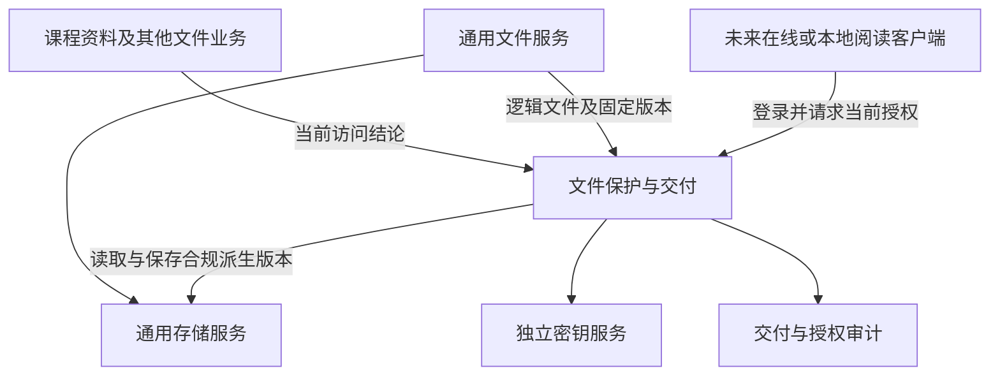

# 文件保护与受控阅读

## 范围与实施状态

**暂不实现，仅保存为后续参考设计。** 本文记录泄露溯源、个性化水印、加密文件容器、登录授权、本地受保护阅读和未来在线阅读器的候选方案。项目负责人于 2026-10-26 要求保留方案，尚未启动接口、客户端或服务端实现。

这些能力用于课程资料及其他需要受控交付的文件业务。当前不要求用户安装解码器，不改变已有资料的下载与购买规则，也不把本方案列为 BHpan adapter 或基础存储能力的交付前提。

项目负责人已进一步明确受限文件的应用层存储加密暂不实现，加密容器和解码器同样延期。业务鉴权、实例准入、传输保护及内容完整性仍独立执行；延期不表示普通用户存储实例可以保管受限明文。

通用文件存储、账号来源和贡献激励的解耦方向见[通用文件与分布式存储](storage-architecture.md)。具体水印方案、容器格式、离线期限、支持文件类型、设备范围及审计保留期仍待评审。

## 四类策略分别表达

| 策略 | 判断对象 | 责任边界 |
| --- | --- | --- |
| 业务访问规则 | 当前用户是否可以读取、编辑或导出文件 | 所属业务或通用文件系统的权限服务 |
| 文件保护要求 | 内容分类、所属范围及必须满足的保护条件 | 业务声明，平台策略校验和审核 |
| 存储准入授权 | 某实例能否承载对应分类、范围和表示形式 | 通用存储服务执行管理员授权 |
| 交付策略 | 标准下载、水印、加密包、在线阅读、打印和离线许可 | 文件保护与交付能力执行当前业务授权 |

积分、Ivory 和会员决定取得访问权的业务条件，不分别定义存储密级。密级给出最低保护要求，交付方式在允许范围内选择；付费不自动意味着必须安装阅读客户端。批准某账号保管密文不授予账号拥有者明文阅读权。

## 模块协作

存储服务管理对象与副本，不理解会员套餐、水印账号或阅读器界面。交付能力通过文件接口取得固定版本，再生成个性化内容、封装或在线阅读结果。业务授权不可用时，受保护交付保持关闭。

文件保护与交付是候选职责边界，具体仓库、Go module 和部署进程未确定。本轮不新增模块登记、空仓库、OpenAPI、SDK 或运行能力；未来实施前再确定接口、数据归属和依赖关系。

## 可追溯交付

| 标识 | 含义 |
| --- | --- |
| 文件版本 ID | 标识原始内容及不可变版本 |
| 交付 ID | 标识一次向某账号提供的个性化副本，同次请求重试沿用原值 |
| 阅读会话 ID | 标识一次获授权阅读，可关联动态水印与访问记录 |

服务端保存交付标识与账号、文件版本、授权时间及策略修订的对应关系。文件中只嵌入不直接暴露姓名、学号或账号的追踪码；查询对应关系需要独立授权与审计。密钥、令牌和原始敏感材料不进入追踪码。

PDF、图片和可渲染文档可生成内容内的个性化水印；音视频需要单独验证对应技术。仅修改文件名、备注、容器头或元数据容易被移除，不视为可靠的内容溯源。隐形水印的识别率与抗变换能力需要实际测试。

需要较强溯源时，候选方式是在服务端生成带标识的内容，再进行加密交付。客户端显示层水印可以辅助阅读提示，但不能单独承担对抗客户端修改的责任。内容转换保留原版本，并验证可读性与语义未被破坏。

溯源结论只能说明某份副本曾交付给哪个账号。账号被盗、设备共用、再次转发、标识伪造和识别错误都可能影响判断，不能单凭追踪码自动认定自然人泄密或执行处罚。调查应结合可校验的交付记录和其他证据。

审计在受控访问、交付或授权检查时产生，不采用文件隐藏外联等方式收集阅读者信息。未来启用前确定用户告知、查询权限、保留上限、清理规则及误判处理；本轮不批准新增长期日志或缓存。

## 加密文件容器

候选容器保存格式版本、文件版本 ID、交付 ID、必要加密参数、密钥引用及受认证保护的内容。敏感文件名等元数据也应按保护要求处理。真正的解密密钥不明文随包保存，不直接由用户登录密码生成。

自定义范围限于容器及业务协议，加密使用成熟算法和经过审查的实现。格式可以公开、可审计，安全性依赖密钥、完整性与授权。认证加密的基本语义参考 [RFC 5116](https://datatracker.ietf.org/doc/html/rfc5116)，本轮不选定具体算法、库或分块格式。

存储主版本不必按每个用户永久复制。交付时生成个性化派生版本，主版本与交付版本的密钥和授权隔离，不向普通客户端下发主版本密钥。临时派生文件须有用途、容量上限、保留期与清理方式，具体预算在实施前确定。

所有预览、缩略图、转码、水印副本和下载包继承对应保护要求。多文件包核对每个版本与当前授权，不能因封装或加密自动降低密级。未知容器版本、完整性失败或授权失败时不输出受保护明文。

## 登录授权与客户端

候选流程为客户端取得加密包后，通过系统浏览器登录 StuHelper；授权服务检查账号、文件版本、业务引用、停用状态和当前交付策略，再签发绑定主体、版本、动作及有效期的授权。

本地客户端使用公有客户端认证方式，沿用 OIDC 与 PKCE，服务管理密钥留在服务端。登录方式参考 [RFC 8252](https://datatracker.ietf.org/doc/html/rfc8252)。容器不能通过自带地址把登录或令牌发送到任意服务，客户端只接受受信任的授权来源。

| 候选方式 | 可提供的能力 | 主要边界 |
| --- | --- | --- |
| 登录后解码并导出 | 控制取得明文的资格，导出内容可含个性化水印 | 导出后无法继续保证访问限制 |
| 本地受保护阅读 | 在兼容客户端内管理阅读、水印、打印和导出策略 | 用户控制终端，仍可能提取明文、密钥或截图 |
| 在线受控阅读 | 服务端持续核对访问权，按需提供已授权内容 | 依赖网络，仍无法阻止拍照、人工转录等行为 |

未来在线阅读器可作为单独扩展，按文件格式逐步开放。服务端对每次受保护请求检查授权及版本，预览和缓存使用同样的权限边界。仅隐藏下载按钮或限制前端操作不能实现受控交付。

在线阅读仍须向终端提供可显示的内容，不保证获授权者无法复制。允许本地解码时，已取得的明文或密钥不能由服务端远程收回，客户端显示的许可证到期也不等于密码学密钥自动失效。

允许离线访问就存在撤销不能立即生效的窗口。微软的[文档撤销说明](https://learn.microsoft.com/en-us/purview/track-and-revoke-admin)也区分离线期限与撤销效果。未来需分别定义停止新授权、兼容客户端离线到期和已导出内容的处理，不能承诺即时收回全部副本。

## 交付组合候选

| 业务需要 | 可评审的交付组合 |
| --- | --- |
| 普通公开文件 | 标准格式下载，可选来源标记 |
| 积分、Ivory 或会员资料 | 检查当前权益，按需要交付带追踪标识的标准文件 |
| 保密文件 | 加密包、登录阅读和个性化水印，打印、导出与离线权限单独配置 |
| 更高保护要求 | 优先评审在线受控阅读，限制原文件和可复用密钥的交付 |

上表是后续参考，不表示已确定全站默认方式。改用受控阅读时还需明确适用内容、跨端与无障碍体验、断网表现，以及既有购买用户的交付安排。不能把已有可下载内容静默改成必须安装客户端。

## 未来启动条件与验收准备

实施须由后续任务明确启动，再确定格式支持矩阵、授权接口、密钥恢复、客户端更新、漏洞响应及资源预算。容器、阅读器和在线服务分别验证，不能以登录成功或文件能打开代替保护能力验收。

| 待验证主题 | 后续需要的证据 |
| --- | --- |
| 溯源与隐私 | 同次交付幂等、不同交付可区分、误判分析、追踪码不泄露身份及查询越权测试 |
| 容器与内容 | 篡改、截断、替换、未知版本及大文件边界测试，派生内容可读性核验 |
| 当前授权 | 权益失效、文件停用、版本变更、授权重放及跨主体访问被正确处理 |
| 在线阅读 | 页面、附件、预览、缓存与导出均受控，失败不返回未授权原文 |
| 离线与撤销 | 明确并验证兼容客户端的离线窗口，不声称收回已保存的明文或密钥 |
| 运维与恢复 | 密钥、元数据、删除状态和授权记录可恢复，临时产物按预算清理 |

以上均未实现、未验收，不登记为 `scenario_tests` 已完成场景。是否实施、实施顺序和已确认参数统一由[存储实施准备](../development/storage-module.md)维护。
