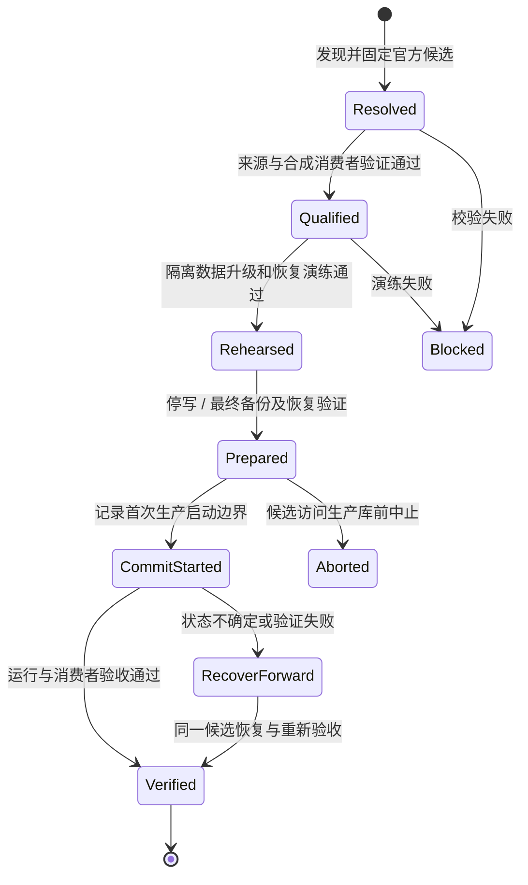

# 独立官方 Casdoor SSO

## 目标与范围

保留现有身份数据与各系统账号绑定，使用官方镜像运行可独立维护的 StuHelper SSO。官方镜像路线已由项目负责人确认，见[ADR-0001](../adr/0001-official-casdoor-image.md)；更新控制器和切换机制属于尚待实施的设计。精确数据与验收要求由[SSO 规格](../spec/sso-compatibility.md)维护。

## 系统边界

- SSO 由官方镜像、独立配置/secret、自己的数据库、需要时独立 Redis/session 存储和独立反代组成。
- 固定既有公共 issuer `https://sso.stuhelper.com`。主站、Next、AI、Store 各自是独立 OIDC client，各自管理本地会话和业务账号。
- SSO 的启动、健康、备份、更新和恢复不调用 StuHelper 业务 API，不查询主站数据库，不依赖主站 Admin 可用。
- 运维入口独立于业务网站，可由受保护工作流或部署主机上的运维命令启动。业务管理员不因此获得 Docker/SSH/数据库凭据。
- 不 fork Casdoor、不重新编译、不打补丁、不把业务代码挂进官方镜像；品牌配置通过官方主题、应用配置和支持的定制入口维护。
- 更新 SSO 不强制发布业务应用；发布业务应用也不能覆盖/降级 SSO 镜像或执行 SSO bootstrap。

官方文档说明 v3 → v4 主要更换前端，数据结构在启动时自动补充；这不构成对 StuHelper 历史配置、扩展或会话的兼容证明。必须用现有数据的隔离副本演练。参考 [v3 → v4](https://casdoor.ai/docs/deployment/upgrade-v3-to-v4/) 与 [数据库迁移](https://casdoor.ai/docs/deployment/db-migration/)。

## 制品与更新入口

直接使用官方 `casbin/casdoor` 镜像，记录发行版本、源码提交、镜像 index 与目标平台 digest。digest 是标识镜像内容的摘要。候选记录保存解析结果，后续分别记录镜像来源核验、接入应用兼容测试和生产批准。需要在 BJ1 Registry 缓存原件时，按[runner 规则](../spec/ci-runners.md)使用自建 runner，保持 digest 一致。

用户通过独立维护命令或受保护工作流发起一次更新，流程自动推进版本解析、资格检查、备份恢复演练、维护切换与验收；业务 Admin 不持有 Docker、SSH 或数据库凭据。Casdoor 镜像不挂载宿主 Docker socket。

官方 v4.23.0 的内置升级按钮适用于官方 release 二进制；本项目采用 Docker，因此一键更新由独立运维入口实现。该工具当前尚不存在，现有能力只有[候选解析](../guide/sso-candidate.md)。见[官方升级说明](https://casdoor.ai/docs/deployment/upgrade/)。

## 更新协作与资源生命周期

自动发现生成确定版本的候选，后续步骤使用同一镜像。演练在限制访问的主机和隔离网络中运行，阻止候选发送真实短信、邮件、支付请求、webhook，以及同步任务和外部身份提供方请求。停止所有写入进程后生成最终一致备份，实际恢复并核对，再记录候选首次接入生产数据库的时间和状态。

同一时间只允许一个协调器持有迁移锁。重复执行时继续同一次迁移，结果未知时先核对实际运行状态。当前镜像、上一个已验证镜像、备份和审计记录分别设置保留规则，清理时保留恢复所需材料。首次大版本升级或兼容性变化经过审查后才能上线。

## 失败与恢复

候选尚未访问生产库时可以中止并恢复旧运行路径。候选首次在线启动后可能立即迁移 schema 和产生后台写入，不能用“还没放流量”当作未写入证明；之后优先保持数据向前修复。旧版本运行于新 schema 必须有明确兼容证据；绝不自动用旧备份覆盖切换后新增的账号、绑定或令牌事实。

隔离备份演练按稳定主键比较用户集合和关键字段，并按规格使用带密钥的摘要核对敏感值。原始数据和摘要密钥留在演练环境中。完整比较清单见规格。

## 实施衔接与待确认事项

当前主仓库已有部分官方原件适配和迁移工具，提取前要确认其调用、secret、控制状态与业务依赖。新的 SSO 运维入口不依赖旧主站请求账本；正式交接须停用旧更新/版本指针写入者，避免两个控制面并发。

生产拓扑、接入应用配置、维护窗口、旧会话差异及运维包权限在[迁移任务](../development/sso-migration.md)中逐项核实，实际部署和登录验收结果也在那里记录。
