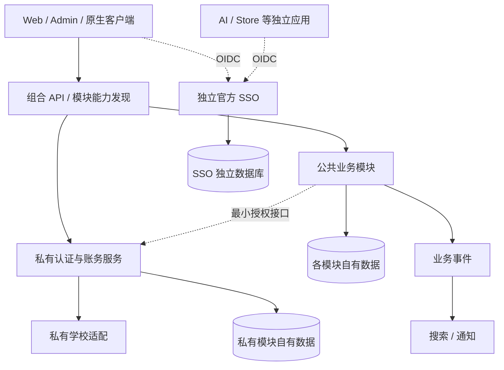

# 平台架构

## 目标与范围

本文提出校园业务模块的协作方式、数据归属和服务拆分条件。模块的启停和扩展行为由[模块生命周期规格](../spec/module-lifecycle.md)定义，实施阶段见[重写计划](../development/rewrite-roadmap.md)。

完整业务见[业务范围](business-scope.md)。模块、仓库和数据归属以[多仓库设计](module-repositories.md)及机器可读清单为准。

## 系统边界与总体架构

采用独立身份服务、按模块拆仓的业务系统和原生多端。每个模块独立维护代码、数据、接口、版本与启停流程。公共模块可以组合部署，私有认证、学校适配、账务与 SSO 分别管理服务和访问权限。

首期业务实现建议使用 Go 与 PostgreSQL，Redis 用于缓存和限流等可重建状态，文件使用兼容 S3 的对象存储。具体依赖版本在实现阶段固定，不复制旧仓库的全部工程复杂度。

SSO 可以独立登录、启动、更新和恢复。AI、Store 与现有 Payment 保留原有职责，身份使用 OIDC 接入。OIDC 是应用使用统一登录的协议，业务模块不访问 SSO 数据库。

## 模块与数据所有权

catalog 管理公共学校目录、课程、教师和课表，verification 管理学生资格与实名，campus-adapters 管理学校接入。三者通过接口协作，公共学校目录不保存认证材料或学校核验实现。

reviews 管理课程评价、导师评论及其回复、投票、收藏和草稿。教师评分由课程评价派生。community 管理社交动态和关注关系，关闭 community 不影响评价自身的互动。

resources 管理资料、版本、访问与交付。billing 管理货币、交易及其产生的权益凭据。资料可以在未安装 billing 时提供免费能力，涉及收费的功能只有在所需能力可用时启用。

platform 管理模块能力、动作资格配置与授权范围。Casdoor 目标组织的有效 `IsAdmin` 仍为全局管理员身份的权威来源，学校与业务范围通过业务授权记录管理。不能把普通 provider roles 当成管理授权，也不能由某个插件绕过服务端权限检查。

## 业务协作与一致性

1. 每个模块按 `domain / application / ports / adapters` 组织，分别存放业务规则、用例编排、接口定义和外部系统适配。HTTP handler 和数据库 repository 属于适配器，由程序入口统一组装依赖。小模块可减少目录层数，避免没有实际逻辑的逐层转发。
2. 每个模块拥有自己的 schema（表的命名空间）、迁移和数据库访问身份。公共模块可共用数据库实例，但只读写自己的表。私有模块与 SSO 独立管理数据库。跨模块不共享 ORM 实体，不直接跨库查询。
3. 同步调用走公开应用接口。组合查询由 API 聚合层或可重新构建的查询数据完成，避免客户端为一页内容发送大量请求。模块间使用稳定 ID，不依赖 ID 中的编码含义。
4. 业务写入、相关审计和 outbox 在同一事务提交。事件采用至少一次投递，因此可能重复，接收方按 event ID 去重，并使用业务对象的 revision（修订号）阻止旧事件覆盖新状态。重试有次数或时间上限，持续失败的事件进入死信队列等待处理。
5. 如果多个模块的操作必须一起成功或失败，设计明确的协调事务。允许分步完成的流程则记录进度，并为失败步骤设计补偿操作。文件先上传到隔离区，确认业务引用后发布，未被引用的文件由有处理上限的后台任务清理。
6. 搜索、计数和信息流由业务数据生成，可以有明确的短暂延迟。返回结果时仍要检查当前权限、屏蔽关系和下架状态，及时移除不可见内容。
7. Web BFF 是供浏览器使用的后端，可保存 OIDC 会话并组合页面数据。课程和审核规则继续由业务模块执行。移动端 API 单独定义公有客户端的认证方式。
8. 各模块独立测试。后续 CI 检查跨模块私有导入、直接访问其他 schema，以及破坏接口兼容的修改。当前检查器验证设计清单中的仓库归属、私有范围和依赖图，业务契约测试在接口实现后加入。

## 运行与质量

公共模块可以在组合 API 与 worker 中运行，也可以注册为独立服务。每个模块拥有健康检查、配置验证、任务停止与排空流程。安装方式不改变数据所有权。worker 是处理后台任务的进程，Outbox 是与业务写入同事务保存的待发送事件。

运行质量包括结构化脱敏日志、请求追踪、分别检查存活与就绪、可取消任务、有容量上限的队列，以及重复请求不重复产生业务结果的幂等 API。数据库恢复需要实际演练，恢复不得覆盖切换后已经完成的新写入。

服务质量目标 SLO、可接受数据丢失时间 RPO 和恢复时间 RTO，在业务优先级与基准测试明确后确定。

## 仓库内结构与发布

每个业务模块仓库按需包含 `docs/`、`contracts/`、实现目录、迁移与模块检查。目录层次按模块规模选择。模块接口生成 SDK，使用方固定兼容版本，避免复制私有实现。跨仓库版本组合和生产配置由私有部署仓库维护。

客户端分别在 Web、Admin、微信、Android、iOS 和 HarmonyOS 应用仓库开发。客户端共享接口与设计规范，各端保留原生界面和平台生命周期。SSO 工具与候选检查迁入私有 SSO 仓库，仍保留完整检查。

## 实施状态与后续设计

当前为设计与文档迁移，尚无运行时注册器或业务服务。跨模块原子流程、接口兼容测试、服务发现与容量目标随实现补齐。OpenFGA 是否需要在首期引入，由具体授权用例决定。

本设计遵循[多仓库决策](../adr/0004-modular-multi-repository.md)。现有已确认的业务规则继续迁移，不因仓库划分而删减功能。
