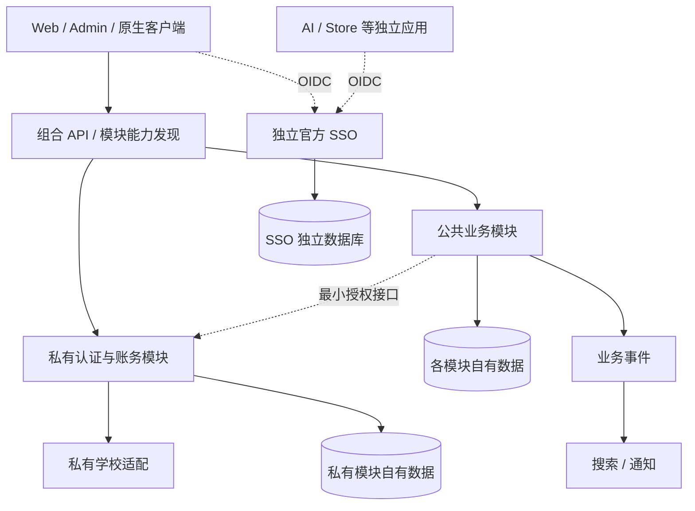

# 平台架构

## 目标与范围

本文提出校园业务模块的协作方式、数据归属和服务拆分条件。模块的启停和扩展行为由[模块生命周期规格](../spec/module-lifecycle.md)定义，实施阶段见[重写计划](../development/rewrite-roadmap.md)。

完整业务见[业务范围](business-scope.md)。模块、仓库和数据归属以[多仓库设计](module-repositories.md)及机器可读清单为准。

## 系统边界与总体架构

采用独立身份服务、按模块拆仓的业务系统和原生多端。每个模块独立维护代码、数据、接口、版本与启停流程。公开和私有业务模块可共同编译进私有 backend，模块继续独立管理数据访问权限。官方 Casdoor 与 Koishi 独立运行。

首期业务实现建议使用 Go 与 PostgreSQL，Redis 用于缓存和限流等可重建状态，文件使用兼容 S3 的对象存储。具体依赖版本在实现阶段固定，不复制旧仓库的全部工程复杂度。

SSO 可以独立登录、启动、更新和恢复。AI、Store 与现有 Payment 保留原有职责，身份使用 OIDC 接入。OIDC 是应用使用统一登录的协议，业务模块不访问 SSO 数据库。

## 模块与数据所有权

catalog 管理公共学校目录、课程、教师和课表，verification 管理学生资格与实名，campus-adapters 管理学校接入。三者通过接口协作，公共学校目录不保存认证材料或学校核验实现。

reviews 管理课程评价、导师评论及其回复、投票和草稿。favorites 管理收藏和收藏夹。教师评分由课程评价派生。community 管理社交动态和关注关系，关闭 community 不影响评价自身的互动。

resources 管理资料、版本、访问与交付。billing 管理货币、交易及其产生的权益凭据。资料可以在未安装 billing 时提供免费能力，涉及收费的功能只有在所需能力可用时启用。

platform 管理模块能力、动作资格配置与授权范围，并提供接收事实输入的公共规则求值接口。各业务模块的 Service 获取当前配置和所需事实，完成最终业务判断。Casdoor 目标组织的有效 `IsAdmin` 仍为全局管理员身份的权威来源，学校与业务范围通过业务授权记录管理。不能把普通 provider roles 当成管理授权，也不能由某个插件绕过服务端权限检查。

qq-binding 拥有三项 QQ 身份、验证码、OAuth 状态、审计和 outbox。Koishi 插件通过受权接口提交私聊验证码，开放平台和群服务通过公开接口读取当前整体状态。

## 业务协作与一致性

1. 每个模块按 `domain / application / ports / adapters` 组织，分别存放业务规则、用例编排、接口定义和外部系统适配。HTTP handler 和数据库 repository 属于适配器，由程序入口统一组装依赖。小模块可减少目录层数，避免没有实际逻辑的逐层转发。
2. 每个模块拥有自己的 schema（表的命名空间）、迁移和数据库访问身份。模块可共用数据库实例，但只读写自己的 schema 并使用独立访问身份。SSO 独立管理数据库。跨模块不共享 ORM 实体，不直接跨库查询。
3. 同步调用走公开应用接口。组合查询由 API 聚合层或可重新构建的查询数据完成，避免客户端为一页内容发送大量请求。模块间使用稳定 ID，不依赖 ID 中的编码含义。
4. 业务写入、相关审计和 outbox 在同一事务提交。事件采用至少一次投递，因此可能重复，接收方按 event ID 去重，并使用业务对象的 revision（修订号）阻止旧事件覆盖新状态。重试有次数或时间上限，持续失败的事件进入死信队列等待处理。
5. 如果多个模块的操作必须一起成功或失败，设计明确的协调事务。允许分步完成的流程则记录进度，并为失败步骤设计补偿操作。文件先上传到隔离区，确认业务引用后发布，未被引用的文件由有处理上限的后台任务清理。
6. 搜索、计数和信息流由业务数据生成，可以有明确的短暂延迟。返回结果时仍要检查当前权限、屏蔽关系和下架状态，及时移除不可见内容。
7. Web BFF 是供浏览器使用的后端，可保存 OIDC 会话并组合页面数据。课程和审核规则继续由业务模块执行。移动端 API 单独定义公有客户端的认证方式。
8. 各模块独立测试。当前检查覆盖跨模块实现包导入、接口兼容、模块元信息与设计清单的一致性。首个数据库实现同时增加模块数据库身份的越界访问测试。

## 运行与质量

业务模块可以在 backend 的 API 与 worker 中运行，也可以按实际需要注册为独立服务。每个模块拥有健康检查、配置验证、任务停止与排空流程。安装方式不改变数据所有权。worker 是处理后台任务的进程，Outbox 是与业务写入同事务保存的待发送事件。

运行质量包括结构化脱敏日志、请求追踪、分别检查存活与就绪、可取消任务、有容量上限的队列，以及重复请求不重复产生业务结果的幂等 API。数据库恢复需要实际演练，恢复不得覆盖切换后已经完成的新写入。

服务质量目标 SLO、可接受数据丢失时间 RPO 和恢复时间 RTO，在业务优先级与基准测试明确后确定。

## 仓库内结构与发布

每个业务模块仓库按需包含 `docs/`、`contracts/`、实现目录、迁移与模块检查。目录层次按模块规模选择。模块接口生成 SDK，使用方固定兼容版本，避免复制私有实现。跨仓库版本组合和生产配置由私有部署仓库维护。

客户端分别在 Web、Admin、微信、Android、iOS 和 HarmonyOS 应用仓库开发。客户端共享接口与设计规范，各端保留原生界面和平台生命周期。SSO 工具与候选检查迁入私有 ops 仓库，仍保留完整检查。

## 实施状态与后续设计

公共运行时与 Web/Admin 框架按[框架实现设计](framework-runtime.md)搭建，当前进度见[框架工作记录](../development/framework-bootstrap.md)。业务服务、跨模块事务和容量目标随业务实现补齐。OpenFGA 是否需要在首期引入，按具体授权用例评估。

本设计遵循[多仓库决策](../adr/0004-modular-multi-repository.md)。现有已确认的业务规则继续迁移，不因仓库划分而删减功能。

## 上游线路选择

跨进程上游使用显式配置的有序候选：本机 loopback 或同机网络优先，其次云私网，最后公网域名。程序不扫描网络、不猜测地址。新增上游登记正式身份、候选名称、地址和故障阈值，并提供不携带凭据的身份探测。

backend 的共享内部 upstream 包负责选择与传输，Casdoor 是第一个使用者。同进程模块继续通过函数和公开服务接口调用，不为线路选择引入额外网络层。

每条 HTTPS 线路都验证正式域名的 TLS 证书，连接私网 IP 时仍使用正式域名作为 ServerName。明文 HTTP 仅接受 loopback IP，跨主机私网和 Docker 地址必须使用 TLS 或 mTLS。OIDC issuer 固定为公开 HTTPS 身份。

配置示例为 upstream.candidates 数组，每项包含 name、url。顺序代表成本；failure_threshold 默认 3，可设为 1–10。最多八条候选，拒绝重复名称、地址、嵌入凭据、路径、查询参数和不安全明文地址。

启动时逐条探测，每条最多一秒，选中最靠前的可用线路后固定使用。运行期间没有周期探测。当前线路连续出现连接、超时或 TLS 错误达到阈值时，检查后续候选并切换；上游业务错误和 HTTP 5xx 不触发切换。

切走后不自动切回。下次重启重新从首条选择，运维也可通过私有 Unix socket 执行 upstream-routes --reselect。普通 upstream-routes 查询当前线路、选择结果、连续失败数和原因，不产生上游请求。

自动重试仅用于没有请求体的 GET、HEAD 和 OPTIONS。POST 等写入不自动重放，即使传输失败也交由业务流程查询结果后处理。选择日志只含候选名称和固定原因，不记录凭据或请求载荷。

学校同步中继与普通上游统一遵循“配置候选、按成本排序、验证远端身份、失败后向后尝试、不周期探测”。学校同步以整批为单位切换并保留旧完整副本；普通 HTTP 上游按请求语义决定能否重试。
