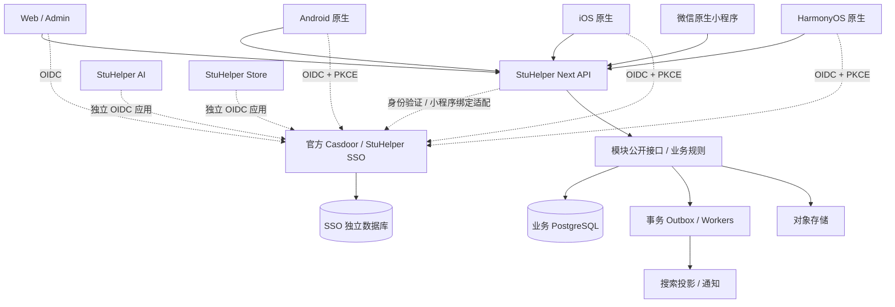

# 平台架构

## 目标与范围

解释校园业务模块如何协作、谁拥有数据以及何时拆分服务。本文为实现提案；模块的启停和扩展行为由[模块生命周期规格](../spec/module-lifecycle.md)定义，交付阶段见[重写计划](../development/rewrite-roadmap.md)。

## 系统边界与总体架构

采用“独立身份服务 + 模块化业务后端 + 原生多端”。模块化指代码、数据、契约、权限和生命周期边界清楚；不要求第一天把所有模块做成独立微服务。

首期业务后端建议 Go + PostgreSQL，Redis 仅用于缓存/限流等可重建状态，文件放兼容 S3 的对象存储。沿用团队现有能力，但不复制旧仓库的整体工程与部署复杂度。具体依赖版本在实现阶段固定受支持版本和 lockfile。



SSO 不向 StuHelper Next 请求许可才能登录、启动、更新或恢复。AI、Store、Payment 的业务、账号映射和数据继续由各自系统维护。SSO 不承载课程、校园认证资料、社交图谱、订单或支付账本。

## 模块与数据所有权

| 模块 | 拥有的事实 | 对外接口 / 事件 |
| --- | --- | --- |
| identity | `(issuer, subject) -> user_id`、本应用会话；不拥有密码或 Casdoor 用户表 | 当前身份、会话撤销、IdentityLinked |
| access | 校园/版块授权与审核权限账本；Casdoor 组织管理员事实的投影 | 检查 capability 和 scope、GrantChanged |
| profiles | 昵称、简介、头像引用、用户偏好、隐私设置 | 用户名片；不自动披露学号/手机 |
| campus | 学校、院系、学期、学生资格及证据索引 | 学校范围、资格查询与变化事件 |
| catalog | 课程目录、开课批次、教师、授课关联 | 课程/教师详情、OfferingChanged |
| reviews | 课程评价、教师评价、版本与评分 | 发布/编辑评价、ReviewPublished |
| resources | 往年题、笔记、资料元数据、来源和使用权限 | 授权下载、ResourcePublished |
| social | 动态、关注、屏蔽、点赞、收藏、评论/回复 | 内容互动、FollowChanged |
| moderation | 审核案件、举报、处置、申诉和审计 | 发布决策、VisibilityChanged |
| media | 上传、扫描、文件状态、对象存储引用 | 创建上传、检查文件可用、MediaReady |
| search | 可重建的搜索文档和游标 | 跨模块搜索；不是业务权威 |
| notifications | 站内通知、发送意图、投递记录与偏好 | 订阅领域事件、通知已读 |
| integrations | AI/Store/机器人/外部学校系统的窄适配器 | 稳定契约、幂等 webhook |

学生资格是 StuHelper 业务事实，与 Casdoor“登录账号存在”分开。已有组织管理员权威不改成 token 的泛化 roles：Casdoor 目标组织有效 `IsAdmin` 决定全局管理员身份；学校/版块权限由业务授权账本维护，敏感操作服务端复核。OpenFGA 可作以后复杂资源关系的可重建投影，第一版是否需要由授权用例决定。

## 业务协作与一致性

1. 每个模块按 `domain / application / ports / adapters` 组织。HTTP handler 和数据库 repository 均为适配器；组合根统一注入依赖。目录数量可随模块大小缩减，禁止空层层转发。
2. 业务 PostgreSQL 的公共学校、院系和学期事实由 campus 模块拥有，catalog 只持有稳定引用并通过接口读取。初期同一个业务 PostgreSQL 实例内每模块独立 schema 与迁移目录，业务数据与 SSO 库绝不混用。写入只能由所属模块负责；跨模块不直接读写对方表，也不共享 ORM entity。
3. 同步调用走公开应用接口。查询组合通过 API 聚合层或可重建读模型完成，避免让客户端发十余次请求组装一页。模块间 ID 是稳定、不透明的标识。
4. 所属模块的业务写入、审计和 outbox 在同一数据库事务提交。异步消费采用至少一次投递、event ID 去重、aggregate revision 排序/防倒退、有界重试与死信处理。不得声称消息系统提供端到端 exactly-once。
5. 只对真实跨模块原子不变量定义显式协调事务；否则用意图/补偿状态，避免隐含跨库事务。文件上传先进入隔离区，业务引用确认后发布，孤儿文件由有界后台任务清理。
6. 搜索、计数和 feed 是投影，允许明确的短暂延迟。撤权、屏蔽、审核下架和下载权限在返回结果时实时过滤，不等待索引最终一致。
7. Web BFF 可持有服务端 OIDC 会话，移动 API 提供面向公有客户端的认证契约；BFF 只编排展示与会话，不复制课程/审核等业务规则。
8. 模块可独立测试；后续 CI 增加禁止跨模块私有 import、schema 访问和契约破坏的自动检查。当前清单校验仅检查设计依赖图，不能替代实现约束。

## 运行、质量与拆分策略

最初运行两个业务进程 `api`、`worker`，同一代码库、独立扩容；SSO 自身单独部署。对象存储、备份与监控也有独立运维责任。首次部署优先 Compose，已有容量和调度需求时再采用 Kubernetes。

只有出现独立扩缩容、故障隔离、团队所有权或数据隔离需求时再提取服务。优先候选是搜索、媒体处理、通知和后续实时消息。课程与开课、教师的关联查询先留在同一 catalog 模块，减少无收益的网络调用。

运行质量要求：结构化脱敏日志、OpenTelemetry trace、就绪/存活分离、后台任务可取消、有界队列、幂等 API、数据库 PITR 与实际恢复演练。容量/SLO 和 RPO/RTO 在基准测试与业务优先级确定后填写，不先编造数字。

## 代码与部署边界

```text
apps/web/                 Web 原生浏览器应用
apps/admin/               管理端（共享 Web 工具，不共享权限判断）
apps/wechat/              微信原生小程序
apps/android/             Kotlin / Jetpack Compose
apps/ios/                 Swift / SwiftUI
apps/harmony/             ArkTS / ArkUI
server/cmd/api/            API 组合根
server/cmd/worker/         Worker 组合根
server/modules/<module>/  业务模块及其 migration
contracts/openapi/        HTTP 契约
contracts/events/         事件 schema
sdks/                     生成的 TS / Kotlin / Swift / ArkTS 客户端
design/                   设计 token、图标源与跨端交互规范
ops/sso/                  可独立导出、独立版本化的 SSO 运维包
ops/app/                  业务系统部署
```

SSO 运维包初期放在本仓库便于审查，但不得导入 server、使用业务数据库或要求业务服务在线；发布独立 SSO 运维制品，之后需要仓库权限隔离时再迁出。其源码始终来自 `casdoor/casdoor`，不是另建产品 fork。

## 风险与待确认事项

同一业务数据库的 schema 分区是所有权约束，尚未实现每模块数据库角色隔离；后续必须用 import 规则、Repository 边界和必要的数据库授权验证边界。OpenFGA 的首期必要性、具体依赖版本及容量目标在对应实现前确认。模块清单的 optional 仅表达能力订阅与适配，不允许形成跨模块私有实现的循环依赖。

## 关联与确认依据

SSO 官方镜像和 CI 网络分工已见[决策记录](../adr/README.md)。模块设计来自本次重写需求的方案讨论，未将技术建议视为整体实施批准。模块依赖图的机器可读草案是[modules.json](https://github.com/StuHelper/stuhelper-next/blob/develop/architecture/modules.json)，目前只验证设计清单，不是运行时加载器。
