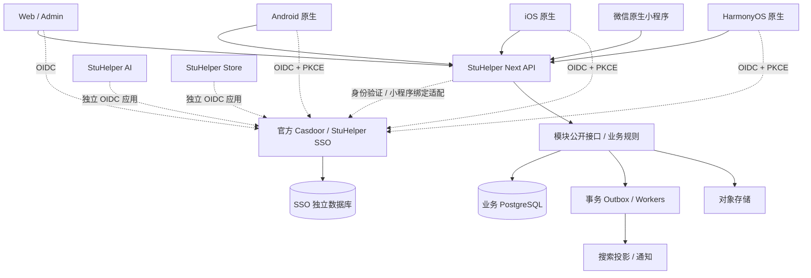

# 平台架构

## 目标与范围

本文提出校园业务模块的协作方式、数据归属和服务拆分条件。模块的启停和扩展行为由[模块生命周期规格](../spec/module-lifecycle.md)定义，实施阶段见[重写计划](../development/rewrite-roadmap.md)。

完整业务见[业务范围](business-scope.md)。下面的模块清单是早期草案。可选实名、课表、QQ 群管理、开放平台、存储贡献以及积分与余额的模块归属仍待设计。

## 系统边界与总体架构

采用独立身份服务、模块化业务后端和原生多端。模块分别管理自己的代码、数据、接口、权限和启停行为，首期可以在同一个服务中运行。

首期业务后端建议 Go + PostgreSQL，Redis 仅用于缓存/限流等可重建状态，文件放兼容 S3 的对象存储。沿用团队现有能力，但不复制旧仓库的整体工程与部署复杂度。具体依赖版本在实现阶段固定受支持版本和 lockfile。



SSO 可以独立登录、启动、更新和恢复。AI、Store、Payment 的业务、账号映射和数据由各自系统维护。课程、学生认证资料、社交关系、订单和支付账本保存在对应业务系统中。

OIDC 是应用接入统一登录的协议。图中的 Outbox 是与业务记录在同一事务中保存的待发送事件，worker 是处理这些事件的后台进程。搜索投影是从业务数据生成、可以重新构建的搜索记录。

## 模块与数据所有权

| 模块 | 拥有的事实 | 对外接口 / 事件 |
| --- | --- | --- |
| identity | `(issuer, subject) -> user_id`、本应用会话；不拥有密码或 Casdoor 用户表 | 当前身份、会话撤销、IdentityLinked |
| access | 校园/版块授权与审核权限账本；Casdoor 组织管理员事实的投影 | 检查 capability 和 scope、GrantChanged |
| profiles | 昵称、简介、头像引用、用户偏好、隐私设置 | 用户名片；不自动披露学号/手机 |
| campus | 学校、院系、学期、学生资格及证据索引 | 学校范围、资格查询与变化事件 |
| catalog | 课程目录、开课批次、教师、授课关联 | 课程/教师详情、OfferingChanged |
| reviews | 课程评价、教师评价、版本与评分 | 发布/编辑评价、ReviewPublished |
| resources | 往年题、笔记、资料元数据、来源和使用权限 | 授权下载、ResourcePublished |
| social | 动态、关注、屏蔽、点赞、收藏、评论/回复 | 内容互动、FollowChanged |
| moderation | 审核案件、举报、处置、申诉和审计 | 发布决策、VisibilityChanged |
| media | 上传、扫描、文件状态、对象存储引用 | 创建上传、检查文件可用、MediaReady |
| search | 可重建的搜索文档和游标 | 跨模块搜索；不是业务权威 |
| notifications | 站内通知、发送意图、投递记录与偏好 | 订阅领域事件、通知已读 |
| integrations | AI/Store/机器人/外部学校系统的窄适配器 | 稳定契约、幂等 webhook |

学生资格是 StuHelper 业务事实，与 Casdoor“登录账号存在”分开。已有组织管理员权威不改成 token 的泛化 roles：Casdoor 目标组织有效 `IsAdmin` 决定全局管理员身份；学校/版块权限由业务授权账本维护，敏感操作服务端复核。OpenFGA 可作以后复杂资源关系的可重建投影，第一版是否需要由授权用例决定。

## 业务协作与一致性

1. 每个模块按 `domain / application / ports / adapters` 组织，分别存放业务规则、用例编排、接口定义和外部系统适配。HTTP handler 和数据库 repository 属于适配器，由程序入口统一组装依赖。小模块可减少目录层数，避免没有实际逻辑的逐层转发。
2. campus 管理学校、院系和学期，catalog 保存稳定引用并通过接口读取。首期在同一个业务 PostgreSQL 实例中为各模块划分独立 schema（表的命名空间）和迁移目录。模块只读写自己的表，通过接口访问其他模块的数据，不共享 ORM 实体。SSO 使用独立数据库。
3. 同步调用走公开应用接口。组合查询由 API 聚合层或可重新构建的查询数据完成，避免客户端为一页内容发送大量请求。模块间使用稳定 ID，不依赖 ID 中的编码含义。
4. 业务写入、相关审计和 outbox 在同一事务提交。事件采用至少一次投递，因此可能重复，接收方按 event ID 去重，并使用业务对象的 revision（修订号）阻止旧事件覆盖新状态。重试有次数或时间上限，持续失败的事件进入死信队列等待处理。
5. 如果多个模块的操作必须一起成功或失败，设计明确的协调事务。允许分步完成的流程则记录进度，并为失败步骤设计补偿操作。文件先上传到隔离区，确认业务引用后发布，未被引用的文件由有处理上限的后台任务清理。
6. 搜索、计数和信息流由业务数据生成，可以有明确的短暂延迟。返回结果时仍要检查当前权限、屏蔽关系和下架状态，及时移除不可见内容。
7. Web BFF 是供浏览器使用的后端，可保存 OIDC 会话并组合页面数据。课程和审核规则继续由业务模块执行。移动端 API 单独定义公有客户端的认证方式。
8. 各模块独立测试。后续 CI 检查跨模块私有导入、直接访问其他 schema，以及破坏接口兼容的修改。当前检查器仅验证设计清单中的依赖图。

## 运行、质量与拆分策略

最初运行两个业务进程 `api`、`worker`，同一代码库、独立扩容；SSO 自身单独部署。对象存储、备份与监控也有独立运维责任。首次部署优先 Compose，已有容量和调度需求时再采用 Kubernetes。

只有出现独立扩缩容、故障隔离、团队所有权或数据隔离需求时再提取服务。优先候选是搜索、媒体处理、通知和后续实时消息。课程与开课、教师的关联查询先留在同一 catalog 模块，减少无收益的网络调用。

运行质量要求包括结构化脱敏日志、OpenTelemetry 请求追踪、分别检查进程存活和服务就绪、可取消的后台任务、有容量上限的队列，以及重复调用不会产生重复业务结果的幂等 API。数据库需要支持按时间点恢复（PITR），并实际演练恢复。

服务质量目标（SLO）、可接受的数据丢失时间（RPO）和恢复服务时间（RTO），在业务优先级和基准测试确定后填写。

## 代码与部署边界

```text
apps/web/                 Web 原生浏览器应用
apps/admin/               管理端（共享 Web 工具，不共享权限判断）
apps/wechat/              微信原生小程序
apps/android/             Kotlin / Jetpack Compose
apps/ios/                 Swift / SwiftUI
apps/harmony/             ArkTS / ArkUI
server/cmd/api/            API 组合根
server/cmd/worker/         Worker 组合根
server/modules/<module>/  业务模块及其 migration
contracts/openapi/        HTTP 契约
contracts/events/         事件 schema
sdks/                     生成的 TS / Kotlin / Swift / ArkTS 客户端
design/                   设计 token、图标源与跨端交互规范
ops/sso/                  可独立导出、独立版本化的 SSO 运维包
ops/app/                  业务系统部署
```

SSO 运维包初期放在本仓库便于审查，独立打包和发布。运维包不导入 server、不使用业务数据库，也不要求业务服务在线。需要单独管理仓库权限时，再迁出运维包。Casdoor 源码始终来自官方 `casdoor/casdoor`。

## 风险与待确认事项

同一业务数据库的 schema 分区是所有权约束，尚未实现每模块数据库角色隔离；后续必须用 import 规则、Repository 边界和必要的数据库授权验证边界。OpenFGA 的首期必要性、具体依赖版本及容量目标在对应实现前确认。模块清单的 optional 仅表达能力订阅与适配，不允许形成跨模块私有实现的循环依赖。

## 关联与确认依据

SSO 官方镜像和 CI 网络分工已见[决策记录](../adr/README.md)。模块设计来自本次重写需求的方案讨论，未将技术建议视为整体实施批准。模块依赖图的机器可读草案是[modules.json](https://github.com/StuHelper/stuhelper-next/blob/develop/architecture/modules.json)，目前只验证设计清单，不是运行时加载器。
