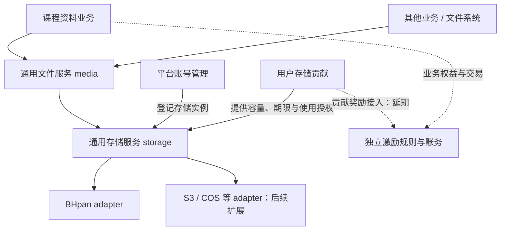

# 通用文件与分布式存储

## 目标与确认范围

**实施状态：基础存储与通用文件已通过隔离环境联调，生产验收尚未完成。** BHpan adapter、storage 和 media 保持独立，backend 注入身份和供应商实现。贡献管理与在线托管入口已实现，实际身份与生产验收待完成；在线阅读器、加密容器及溯源继续延期，见[文件保护与受控阅读](file-protection-and-delivery.md)。

文件与存储是 StuHelper 全系统的通用能力，课程资料、个人文件系统及其他业务通过稳定文件引用使用它。支持多个存储实例、副本修复、保护分类和多 adapter 混合放置。首期实际后端候选为 BHpan，后续可接入 S3、COS 等存储。

项目负责人于 2026-10-26 确认通用存储、业务使用、账号贡献和激励相互解耦。平台与用户都可提供存储实例，管理员可按分类及业务范围批准用户实例承载受限文件；具体保护参数与启用条件仍待评审。

首期目标确认为三份完整副本，首次发布门槛确认为两份。受限文件的应用层加密明确延期，相关设计保留为未来参考，不因延期自动降低文件保护要求或扩大实例准入。

当前容灾范围为账号失效、撤权、容量不足、误删和文件损坏，不考虑整个 BHpan 服务故障，不要求跨服务商副本。具体候选行为见[放置与恢复规格](../spec/storage-placement.md)，进度见[实施准备](../development/storage-module.md)。

## 模块职责

| 对象 | 职责 |
| --- | --- |
| resources 等业务 | 业务内容、访问权益、审核与发布；给出当前访问结论和文件保护要求 |
| 通用文件服务 | 上传会话、逻辑文件及版本、业务引用、元数据和文件访问入口；现有 media 承接此入口 |
| 通用存储服务 | 存储实例、容量、放置策略、物理副本、完整性校验、修复、迁移与清理任务 |
| storage adapter | 提供某种存储协议的能力和操作结果；BHpan 由独立 storage-bhpan 库接入 |
| 平台账号管理 | 托管平台凭据、登记实例与批准用途；不取得业务文件阅读权 |
| 用户存储贡献扩展 | 用户同意、已托管实例选择、额度与期限、续期、暂停、退出和贡献统计 |
| 文件保护与交付扩展 | 个性化水印、加密包和受控阅读；暂不实现，见独立参考设计 |
| 激励与账务 | 接收获准业务事件和核验统计，按独立规则计算奖励并幂等记账 |
| backend | 装配业务模块、adapter 桥接、凭据服务和传输执行器；业务模块不依赖供应商类型 |
| ops | 维护获准运行环境、凭据与密钥服务、容量及传输预算、元数据备份和恢复配置 |

各职责拥有自己的数据与公开接口，业务不直接读写副本或贡献记录。关闭贡献扩展后，平台实例仍可服务；关闭奖励后仍可贡献；不安装课程资料模块，其他业务仍可存文件。存储核心不依赖具体业务、贡献榜或奖励计算。

课程关联、课程资料审核、展示哪个版本、购买权益、下架和投诉由所属业务执行。media 保存不可变版本和引用，通过注入的 Authorizer 检查当前访问结论，不导入课程或账务实现。文件校验及允许发布引用的通用接口不承担课程审核规则。

业务目录组织、选集条件和访问权属于使用方。固定文件版本清单、授权后批量传输与打包可作为通用文件扩展，由调用方提供获准集合并在交付前复核权限；存储仅处理各对象副本，不推断课程目录或购买规则。

贡献榜、奖励计算及贡献到账务的接入已于 2026-10-28 明确延期。保留贡献容量、使用情况和服务状态统计；奖励服务缺失不影响账号托管、贡献生命周期、文件上传或下载，也不作为本轮通用能力的完成条件。

通用存储与文件已建立独立 stuhelper-storage、stuhelper-media 仓库，作为可装配库交付，并提供 OpenAPI 与生成 SDK。backend 配置入口已接入两者及贡献扩展，保护交付继续延期。首期同进程装配、执行器可独立部署的规划见下节。

账号来源与协议分别保存，平台自有和用户贡献的 BHpan、S3 或 COS 接入后均表现为存储实例。存储核心只使用有效容量、期限、能力及准入约束；贡献生命周期由扩展协调，adapter 不判断业务资格或奖励。

上传奖励依据所属业务认可的事件，例如资料审核通过；存储贡献奖励依据核验后的容量、使用和服务统计。存储核心仅发布通用事实，不因写入字节成功就发奖。奖励与贡献榜的口径、去重及核算由各自模块负责。

## 执行器部署与资源预算

本节部署边界已确认，存储执行器、同进程配置入口和独立 worker 命令已实现，生产部署尚未完成。backend 已装配 media、storage 与执行器，各模块通过公开接口和独立数据访问身份协作。业务接口不因执行器迁出进程而改变。

复制、巡检、修复、迁移与清理通过持久化任务账本执行。上传和下载经过有界的传输入口，下载所需的内容校验仍在交付前完成。停止服务时先停止接收和领取新任务，再在限定时间内完成在途操作或保存可恢复进度。

运行配置明确全局及单账号并发、待处理任务上限、连接数、执行超时、重试窗口、传输带宽与临时磁盘预算。达到上限时有限等待或返回可重试状态，不能无限创建后台任务。临时文件按任务记录到期清理，并覆盖异常退出后的回收。

多个账号共享执行器，各自拥有独立的会话、授权状态、凭据引用和存储根。每个账号不单独运行浏览器或容器。账号之间的状态隔离属于程序内部隔离，同一进程中的账号仍共享进程资源和故障范围。

账号探测与续期错开执行时间，失败采用有上限的退避。同一账号的登录或续期只能由一个执行者处理，多进程时使用持久化协调与凭据修订防止重复登录和旧结果覆盖。长期恢复能力仍按持续授权方案验收。

当前本地凭据库由一个进程独占，同账号登录互斥、加密凭据重启恢复和撤销已实现。该限制不等于支持多节点共享凭据；多进程执行须先接入独立凭据服务或分配互不重叠的账号，不能复制同一密钥与凭据库绕过互斥。

同进程模式先通过限流、并发与任务调度控制开销。监控业务请求延迟、队列积压时间、CPU、内存、连接数、磁盘与带宽占用；容量和延迟目标根据实际规模与压测确定。当前会话池的数量上限属于实现保护值，不作为容量承诺。

当实测表明文件传输或集中修复影响业务请求，或者需要独立扩容、重启与故障隔离时，再启用独立部署。独立进程配置相应资源配额；同机部署仍共享磁盘与网络，需要继续执行传输预算。账号数量本身不构成必须拆分的条件。

两种运行方式沿用同一任务账本、幂等身份与租约规则，进程重启或迁移不创建另一套副本事实。跨进程协作使用认证的内部接口或持久化任务，仍检查当前授权。凭据只由获准的执行组件读取，任务与业务接口传递凭据引用。

功能、隔离数据库、故障注入与初步基准可在 Ubuntu 开发环境完成。正式容量基准使用与目标部署接近的独立预发布环境，记录 CPU、内存、磁盘、数据库参数和网络条件；开发机结果不直接作为生产容量承诺。

集中监控的指标与告警先在开发和预发布验证，正式采集由持续运行的运维环境承载。生产验收检查实际路由、身份、权限、配置、告警及小流量文件链路。备份恢复写入隔离目标；极限压测和破坏性故障演练使用独立环境，按获准范围执行。

## 对象与账号模型

| 概念 | 定义 |
| --- | --- |
| adapter | 一类协议实现，例如 bhpan；注册代码与启用具体账号分别管理 |
| 存储实例 | 获准目标、凭据引用、bucket 或专用根及所属账号故障域；同账号多个目标不自动成为独立副本来源 |
| 贡献记录 | 所属用户、贡献上限、个人保留空间、期限、同意版本与退出状态 |
| 逻辑对象版本 | 平台稳定 ID、不可变内容版本、长度、SHA-256、文件保护要求和有效业务引用 |
| 物理副本 | 对象版本在某实例上的远端标识、远端版本、编码方式、校验结果和生命周期 |
| 放置策略 | 允许的密级、实例归属、能力、账号与贡献者隔离、目标副本数和发布门槛 |
| 目录版本 | 固定文件版本、相对路径与摘要的清单，供完整性核对与目录下载使用 |
| 任务代次 | 一次放置、修复、迁移或删除的意图，以及受租约约束的执行尝试 |

平台根据供应商返回的稳定账号标识去重。同一账号经不同登录方式或多个贡献申请接入，不能重复计入容量和独立副本；无法确认归属时先保持待核验。同一贡献者控制的多个账号不算多个独立贡献者。

业务链接只使用逻辑对象和版本。更换账号、adapter 或副本布局不改变业务 ID、引用及访问权；课程资料的购买权益也保持不变。远端名称使用平台生成的标识，原文件名由文件元数据保存并在下载时安全编码。

## 文件索引、会话与周期维护

既有架构已由平台持久保存文件索引，供应商会话只作为访问远端的临时状态。逻辑文件、版本、存储实例、专用根、远端稳定 ID、远端版本、摘要及副本状态分别保存，不用登录态承担文件定位。

列表、搜索、业务授权和文件元数据查询读取本地索引，无需登录 BHpan。远端路径用于定位和展示，稳定 ID 与版本用于核对实际对象；会话丢失不删除索引，索引数据库需要独立备份与恢复。

上传、下载、删除、复制、修复及确有需要的容量或完整性核验才访问供应商。执行任务时复用仍有效的会话；没有会话或会话明确失效时，在当前托管授权内按需登录。同账号并发任务共用登录互斥和会话，不为每个请求重新登录。

后台完整性核验与修复是有预算的维护任务，当前执行器还会周期刷新容量。这些访问用于发现问题和安全分配空间，可能触发登录，但文件索引不依赖持续在线。上传仍须取得有效容量并预占，权限撤销、文件缺失及结果未知分别处理。

现有对象、实例和副本账本、只读索引查询、会话复用及失效重登保持不变。定期容量刷新和内容巡检继续保留，刷新周期、巡检周期与维护扫描周期分别配置。本轮调整是补齐频率配置，不取消后台维护。

存储默认每十二小时刷新账号容量、每二十四小时巡检副本，每六小时分页扫描维护任务，三个周期均可配置。副本核验有效期为四十八小时，容量样本有效期为十八小时。实际执行受排队和供应商耗时影响，过期容量不能继续分配新写。

维护轮次逐批覆盖对象和账号，每轮最多一千批、五分钟，超限保留游标待下轮继续。账号刷新失败会记录错误并继续其他账号。上传、下载和已入队任务独立处理，不等待六小时扫描。

周期配置在 API 同进程及独立 worker 中使用相同规则，修改后重启生效。原 verification_age_seconds 仍兼容，同时给出新旧巡检配置时必须一致。具体字段与边界见 backend README，不表示已有后台界面热更新。

## 文件保护与存储准入

业务访问规则、文件保护要求、存储准入授权和交付策略分别保存。积分、Ivory、会员和内部权限由业务判断，存储核心只接收通用分类、学校或组织范围及保护条件。页面标为公开不自动代表可以向外部分发。

业务通过受控映射提出保护分类，平台校验其权限和最低要求。积分资料与会员资料可以采用同一保护分类，不按套餐创建密级。分类标识、范围和约束共同决定准入，不只比较一个整数等级。

以下为可配置分类示例，名称、数量和默认门槛仍待评审。未分类、待审核和分类冲突的内容先进入获准的受控隔离区，不能由客户端自报公开或先分发后补审。

| 保护分类示例 | 内容示例 | 候选存储准入 | 保护与交付 |
| --- | --- | --- | --- |
| 可公开分发 | 已审核、允许向外部分发的文件 | 任一满足健康、容量和放置约束的获准实例 | 依当前业务访问规则交付 |
| 受控访问 | 购买、会员、指定用户或群体可访问的文件 | 获准承载该分类及范围的平台或用户实例 | 用户实例默认候选为应用层密文，平台授权后解密交付 |
| 组织内部 | 学校、组织或工作区内部文件 | 同时获准承载该分类和所属范围的实例 | 权限由所属业务判断，保护条件独立配置 |
| 敏感内容 | 身份材料、个人证明等 | 所属模块明确批准且满足额外保护条件的环境 | 不因通用文件接口存在而自动开放接入 |

平台托管表达账号控制关系，管理员录入贡献账号不会改变其归属。协议、来源和承载权限独立：自有 S3 不自动获准全部密级，用户 BHpan 也不被永久限定为公开分类。贡献服务可扩展到任何通过接入与用途验证的 adapter。

实例准入授权记录允许分类、学校或组织范围、保护条件、有效期、审批者及修订。授权学校 A 的受限文件不包含其他学校。实例拥有者不能自提密级；容量管理、准入审批、内容阅读和凭据导出分别授权。

向用户控制的实例写入明文会使账号控制者能够取得内容。默认候选方案是在 adapter 前使用应用层认证加密，密钥由独立服务管理；批准保存密文不授予阅读权。需要明文保管时须另行明确授权，不能由存储来源或管理员可信标记隐含推导。

应用层加密暂不实现。过渡期先将受限文件放在明确获准保管明文的平台私有实例，通过服务端鉴权和网关交付；实际分类及范围由管理员显式配置。要求应用层密文的用途继续关闭，普通贡献账号不因此取得明文保管权。

加密不降低原分类，也不能代替准入审批、完整性校验或副本冗余。对象保存算法版本、密钥引用及恢复所需元数据；密钥与元数据恢复一并验证。条件缺失时相应用途保持关闭，不自动降级或改用未经授权的实例。

密级降低须经业务审核；提高密级时先停止不合规交付，再完成合规放置和旧副本清理。已取得的公开副本无法收回。撤销实例准入先停止新的不合规写入，并处理存量迁移；阶段前后均核对准入修订。

业务引用跨密级复用时，取全部有效引用要求的交集。交集为空则建立独立对象版本；新引用不能先关联不合格副本。首期不跨用户、密级和业务授权范围做内容去重，避免摘要或秒传结果泄露文件存在性。

## 多 adapter 与混合放置

通用存储服务定义协议无关端口，backend 将独立库桥接到端口。端口表达读写、精确元数据、删除及结果核验；配额、分片上传、指定版本读取、短期直链、归档和远端复制通过能力声明表达，不假设所有 adapter 能力一致。

能力声明包含验证状态与限制，不能把方法存在当作供应商已验证。错误区分凭据失效、权限拒绝、对象缺失、冲突、容量不足、限流、临时失败和结果未知；上层决定重试、隔离或修复，错误不包含原始响应和凭据。

同一策略允许不同 adapter 的实例共同承载副本。例如后续新增合格对象存储后，一个版本可以同时位于 BHpan 与该实例；首期所有候选均为 BHpan。混合策略按各副本的能力选择读取路径，不取所有 adapter 的最低能力，也不要求账号分属不同供应商。

跨实例复制通过受控执行器读取并写入，验证完整长度和摘要后提交副本。只在同一 adapter 明确支持且验证等价语义时使用远端复制。不同 adapter 的 ETag、版本号和路径格式不能互相比较，也不能代替平台内容摘要。

## 冗余与容量

放置先满足密级、实例归属、账号去重、贡献者隔离、容量、期限和健康等硬约束，再按可用空间、迁移成本和读取性能选择目标。所有副本可以使用同一 BHpan 服务，供应商数量不是当前准入条件。

首期目标确认为三份完整副本，包含首份，不是额外再复制三份。不同副本使用不同账号；贡献副本还须分属不同贡献者。每份副本均须满足分类、范围及保护要求，同账号多个目录不能凑足份数。

发布门槛指新版本首次可供业务发布时，至少需要多少份独立、完整且已校验的合规副本。门槛确认为两份，第三份异步补齐；业务审核与访问鉴权继续独立执行。参数关系为 `2 ≤ 发布门槛 ≤ 目标副本数`。

发布门槛只约束首次开放。已发布版本在剩余一份健康、合规副本时仍可读取并显示欠副本状态，同时优先修复；没有健康副本时停止交付并显示不可用。容量不足不能自动降低目标、使用不合格账号或将未校验副本计为成功。

每个实例使用持久化容量预占，所有 API 和 worker 共同扣减同一预算。平台管理与贡献扩展通过接口提供获准额度、保留空间及期限；存储核心不读取贡献表。统计统一使用物理字节，计入加密和打包开销。

有可核验硬配额时，可分配量取额度余量与供应商余量扣除保留空间、安全余量及未确认预占后的较小值。无硬配额的对象存储使用明确容量及费用预算，不伪造无限可用容量；计费与额度提高另行授权。

配额采样与任务确认通过修订号对账，避免已反映在供应商用量中的写入再次扣减。预占转为已用必须有远端结果；结果未知时先保留预算并核查，不能因租约过期就释放预算并重新写满同一账号。容量过期或个人文件增长时停止新分配，既有副本仍需核验。

副本保护文件，元数据账本和密钥备份保护对象映射及恢复能力。数据库备份不能算作文件副本；文件副本也不能替代元数据恢复。备份按[数据保留规则](../spec/data-retention.md)管理，不增加未授权的长期存储。

## 上传、审核与目录

上传在获准的受控隔离实例中完成，传输服务计算实际长度和摘要并执行内容校验。未明确分类时采取受限保护，条件缺失则拒绝相应上传。校验、必要的业务审核与分类通过后，才按目标策略分发；普通贡献准入不包含隔离文件或敏感附件。

存储服务返回绑定对象版本、分类、实例准入和策略修订的就绪结果，文件服务传递给使用方；所属业务核对当前审核和发布状态。跨模块步骤使用幂等操作与 outbox 恢复。待审引用不能获得公开读取能力，不只信任一次历史通过事件。

首期 adapter 提供服务端流式读写。是否开放浏览器直传须单独验证隔离、签名期限和完成校验，不能把普通上传通过等同于直传已通过。平台临时缓冲有容量上限和过期清理，不成为额外永久存储后端。

单个公开文件保持完整，首期使用完整副本，不引入纠删码或把文件拆成必须重新拼接的应用块。目录按不可变清单管理，可优先放在同一账号的目录中；目录过大时按文件分组，不改变各文件的冗余约束。

目录下载先固定本次有权访问的文件版本，生成恰好覆盖所选文件且无重复的下载包。BHpan 原生归档只能包含这个集合；物理目录混有未授权内容时不能直接打包整个远端目录。归档能力不合格时使用受控打包或明确关闭该能力，不返回残缺成功结果。

## 分布式任务与恢复

多实例存储服务共享持久化任务账本，通过原子领取和租约协调；进程内锁不足以实现互斥。任务绑定对象版本、分类、策略、准入及凭据修订、目标实例和执行代次。worker 只处理获准实例与操作，不接受任意外部 URL、路径或命令。

复制、分片上传及完成确认在每个远端阶段前后重查授权与任务代次。分类提高或凭据撤回后，不再发起旧阶段；已经送达供应商的请求仍可能完成，迟到结果登记为不参与交付的残留并清理，不能声称已中断所有远端请求。

写入先建立操作意图和唯一暂存标识，再调用 adapter。崩溃或超时后查询实际远端结果；无法证明结果时保留“待确认”，按精确对象记录清理债务。旧租约、旧代次和撤权前的完成回执不能将副本标为健康。

修复与退出迁移从健康来源读取，完整核验后原子切换当前副本集合，再清理旧副本。只有元数据相符不能证明内容未损坏，需定期内容校验；来源损坏则隔离并换源，无可信来源时报告当前不可交付并进入恢复处置，不复制坏文件扩大副本数。

删除先持久化停止交付和修复的标记，再逐实例清理。迟到上传或修复完成只能进入清理队列，不能重新开放对象。清理精确限定本任务创建的文件与专用根，不能递归删除贡献者个人目录。

任务使用有界并发、退避和传输预算。单账号错误不会暂停其他健康账号；暂停新写、恢复探测、读取、排空和删除分别判断能力。恢复后的账号先重验内容和容量，再参与放置。

## 贡献扩展与 BHpan 接入

贡献扩展适用于通过验证的 BHpan、S3、COS 等后端，统一管理同意、额度、期限和退出。不同协议使用各自接入方式；缺少容量查询、读取或清理等能力时限制适用用途。首期只开放已验收的实际后端，不以接口存在代替贡献可用。

申请依次完成用户同意、账号归属核验、实时容量读取、专用根确认和隔离测试，再激活贡献额度。授权只用于明确贡献范围；供应商账号授权可能覆盖整个网盘，专用根是平台操作边界，不能宣称供应商已授予目录级权限。

协议库需要显式登录，只持有内存会话。一次性学校认证适用[数据保留规格](../spec/data-retention.md)的任务内使用和十五分钟上限；明确授权的长期存储托管使用独立凭据管理，不套用一次性认证期限。两类材料的用途和撤销分别校验。

长期托管可在明确授权的期限内保存账号密码或专用凭据，保管与撤销见[数据保留规则](../spec/data-retention.md)。首期使用有效会话复用和托管凭据重登，验收当前授权、改密、撤权、重启及需人工授权时的处理。平台自有账号同样适用。

无密码续期指使用供应商提供的续期材料取得新会话，不表示免认证，也不同于用户无需再次输入已托管的密码。BHpan 的该能力尚未验证，作为后续可选优化，不阻塞首期凭据重登路线；不能据此声称供应商支持刷新令牌。

暂停立即停止新放置，现有副本可在授权仍有效时参与读取和迁移。到期前按待迁移量和预算启动排空；续期重新核验容量、授权与期限，不把尚未完成的退出任务静默取消。

正常退出先迁移并校验替代副本，再处理原副本和完成状态。贡献者可从供应商侧随时撤权；平台还应提供立即停止使用凭据的操作。撤权不得因迁移未完成而被阻止，但不将“已停止授权”描述为“文件已迁走”或“远端已删除”。

退出状态分别报告迁移、凭据停用和远端清理。BHpan 删除进入回收站，只有完成必要的彻底删除与核验才算物理清理完成；凭据已失效时保留待清理记录与人工处理入口，不伪报成功。

贡献量、实际可分配量、已用物理量和健康副本量分别统计。贡献榜、奖励计算与账务接入延期；未来启用时只展示自愿公开的资料，按独立规则处理核验统计，不能把冗余份数和申报容量直接等同于奖励。

## 下载与凭据边界

每次下载先由所属业务或文件权限服务检查访问权、版本和停用状态，再由存储服务选择健康、合规副本。授权绑定主体、文件版本和动作，稳定入口不接受用户指定账号或远端路径。加密包、追踪水印和阅读器由交付扩展负责，暂不实现。

短期直链必须满足[模块通信规格](../spec/module-protocol.md)的五分钟上界，并绑定已核验版本。BHpan 库的本地十分钟使用上限不证明供应商 URL 的远端有效期；无法验证五分钟失效或防替换语义时，首期使用受控网关，不向用户暴露供应商 URL。

网关在输出受保护内容前完成对应完整性验证。分块认证加密只输出已通过认证的块；需要整文件校验时先在有界隔离空间校验。失败重试不产生新购买，暂停交付及补偿由所属业务处理，存储核心不执行退款。

凭据和密钥只由获准服务持有，日志、审计、公开统计及业务事件仅包含脱敏标识和状态。贡献者能够修改底层公开副本，下载和修复不能仅凭“账号在线”信任内容。

## 设计取舍与来源

首期选择完整副本和持久化任务，便于 BHpan 单文件读取、验证和恢复。旧版的 lane、shard、校园执行节点和修复代次提供参考，但不整体移植旧数据库、调度器或生产配置。执行器部署位置由 ops 按实际授权环境确定。

旧方案的来源、Next 已有规则、BHpan 能力证据以及待评审选择统一记录在[实施准备](../development/storage-module.md)。三副本由本轮单独确认；旧版长期凭据方案、版权规则和已实现声明不自动成为 Next 的确认结果。

## 在线接入与凭据更新

在线接入属于系统存储能力。首次接入需本人明确同意托管用途与截止时间，服务端验证稳定账号后创建专用根，并登记暂停、零贡献额度的实例。贡献容量和期限由贡献模块另行确认。

凭据更新先用独立客户端验证原账号及原专用根。新凭据保存为待切换修订，旧凭据在实例账本切换前继续可用。账本提交后再清除旧材料；中断时根据原操作标识核对账本并继续，不重新建根。

请求记录只保存授权事实、归属、操作状态和凭据引用，不保存密码。重复键对应不同内容时拒绝，未知结果通过原操作查询与恢复。管理员能查看脱敏状态和恢复已有操作，不能替用户同意托管或读取凭据。

该入口由持有凭据库的进程执行，共用有界登录预算。首期仅在配置化 API 与执行器同进程时启用；独立 worker 的远程凭据入口另行部署，不允许第二个进程绕过凭据库独占锁。

Next SSO 与生产配置由对应任务安排，已结束的长期观测保持关闭。网页接入验收使用实际浏览器、获准测试身份、backend、隔离数据库及真实 BHpan 测试专用根，覆盖接入、更新凭据、贡献条件、文件操作和退出清理。无需等待课程资料或奖励模块。
