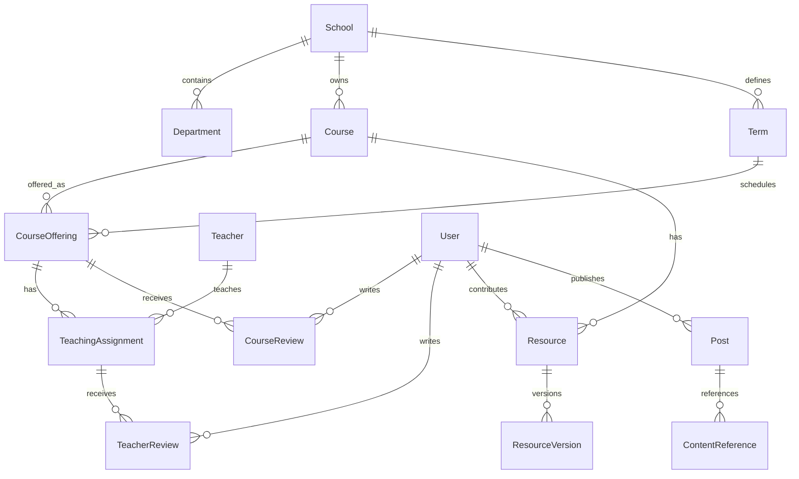

# 课程、教师、资料与社交模型

状态：概念模型。尚未生成数据库 migration，字段和约束将在首个垂直功能中细化。

## 课程目录与每次开课必须分开

`Course` 是学校内可长期识别的课程；`CourseOffering` 是某学期某个教学班的实际开课。教师与开课通过 `TeachingAssignment` 多对多关联，从而支持合授、多个教学班和同一教师跨学期授课。

| 对象 | 关键规则 |
| --- | --- |
| School / Department / Term | 学校范围不可省略；学期编码与课程编码不作为全局 ID |
| Course | 稳定内部 ID、school_id、课程代码/别名、名称、学分及来源；改名保留历史 |
| CourseOffering | course_id、term_id、班号、教学方式；同课程同学期允许多个班 |
| Teacher | 教师是可被评价的主体，不要求教师拥有 StuHelper 登录账号；同名不自动合并 |
| TeachingAssignment | offering_id + teacher_id + 授课角色；保留变更历史 |
| CourseReview | 对一次开课的课程体验评价；汇总到课程，支持学期/教师筛选 |
| TeacherReview | 对教师在一次开课中的授课评价；通过 assignment 定位上下文，汇总到教师 |
| Resource | 必须关联课程，可选关联开课、教师和学期；不确定的历史资料不能伪造精确关联 |
| ResourceVersion | 不可变文件版本、作者/贡献者、许可/来源、文件校验值、审核与可见性 |
| Post / ContentReference | 动态引用课程、开课、教师、评价或资料；保存稳定引用和显示快照，不复制领域事实 |

如果产品需要“未指明开课的历史课程评价”或“教师综合评价”，用显式评价类型表示；不伪造开课记录。旧数据迁移保留旧 ID 映射、原始时间、来源和归属证据，不猜测教师同名或跨校课程等价关系。

## 用户看到的内容组织

- 课程详情：课程基本信息、各学期开课、开课教师、课程评价、历年资料。
- 教师详情：教师简介、按学期排列的开课列表、教师评价、相关公开资料。
- 开课详情：本学期教学班、合授教师、评价维度和具体资料。
- 个人主页：用户公开内容、收藏/关注的可见部分；学习资格和原始身份信息不公开。
- 社交动态：正文与领域引用卡片；引用目标被删除/限制后显示占位并停止披露原内容。

评分采用独立维度及版本（例如课程负担、收获，教师讲授与反馈），不把两类评分混为一个数。统计排除审核撤下、已删除及不符合计入政策的评价，保留样本量和时间区间。唯一性政策由产品决定后落实数据库约束，例如一用户对同一开课仅一份可编辑的有效课程评价。

## 社交第一阶段

范围建议为动态、关注、评论/回复、点赞、收藏、屏蔽、举报、站内通知和按时间排序的信息流。好友私信、群聊、直播、复杂推荐排在后续，分别设计反骚扰、消息存储与实时连接能力。

评论目标采用受控注册表（`course_review`、`teacher_review`、`resource`、`post` 等），目标所属模块负责存在性、可见性和权限校验。注册表不得变成可传任意表名的万能查询接口。关闭 social 后，课程评价正文和资料仍可独立阅读。

## 发布、匿名与治理

内容状态至少区分草稿、待审核、已发布、受限、已下架、已删除；明确审核与发布事务边界。用户的匿名展示身份与后端审计身份分开，是否对外匿名由产品配置和目标范围决定。对外匿名不允许通过 API、日志、搜索、资源路径或通知泄露作者标识。

举报与申诉由 moderation 统一受理，实际内容修改仍由所属模块完成。审核员权限必须同时符合学校/版块 scope 和动作 capability。屏蔽、资格到期、资源撤权、附件签名 URL 过期均纳入读路径验收。

对象存储使用私有 bucket。客户端拿到短期上传授权，文件经过大小、类型、恶意内容检测与审核后才能被发布记录引用；下载授权每次重新检查访问范围。资料需有来源与使用许可字段、版本和下架/申诉流程。
