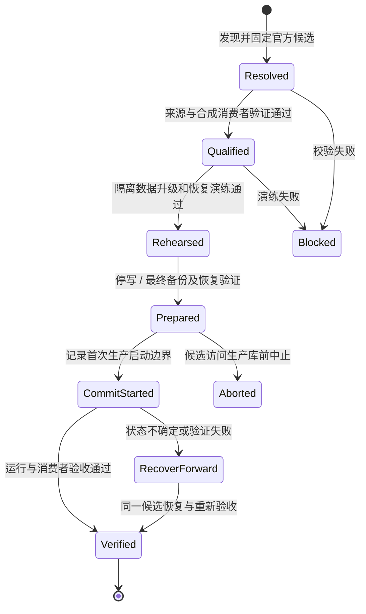

# 独立官方 Casdoor SSO 与升级设计

目标：保留现有 StuHelper SSO 数据与应用身份绑定，直接运行官方 Casdoor 最新稳定 v4，并让它能独立维护。2026-10-23 核实的候选为 **v4.23.0**；候选版本不等于已部署版本。

## 1. 独立边界

- SSO 由官方镜像、独立配置/secret、自己的数据库、需要时独立 Redis/session 存储和独立反代组成。
- 固定既有公共 issuer `https://sso.stuhelper.com`。主站、Next、AI、Store 各自是独立 OIDC client，各自管理本地会话和业务账号。
- SSO 的启动、健康、备份、更新和恢复不调用 StuHelper 业务 API，不查询主站数据库，不依赖主站 Admin 可用。
- 运维入口独立于业务网站，可由受保护工作流或部署主机上的运维命令启动。业务管理员不因此获得 Docker/SSH/数据库凭据。
- 不 fork Casdoor、不重新编译、不打补丁、不把业务代码挂进官方镜像；品牌配置通过官方主题、应用配置和支持的定制入口维护。
- 更新 SSO 不强制发布业务应用；发布业务应用也不能覆盖/降级 SSO 镜像或执行 SSO bootstrap。

官方文档说明 v3 → v4 主要更换前端，数据结构在启动时自动补充；这不构成对 StuHelper 历史配置、扩展或会话的兼容证明。必须用现有数据的隔离副本演练。参考 [v3 → v4](https://casdoor.ai/docs/deployment/upgrade-v3-to-v4/) 与 [数据库迁移](https://casdoor.ai/docs/deployment/db-migration/)。

## 2. 数据保留范围

保留完整数据库及关联持久化资源，不只导出用户名再建账号：

| 数据 | 必须保持/验证 |
| --- | --- |
| 用户 | UUID、组织、用户名、密码哈希与算法参数、资料、禁用/删除状态、管理员状态 |
| 登录因子 | MFA、WebAuthn/passkey、恢复材料、第三方身份绑定及其解密依赖 |
| 组织与应用 | owner/name、client ID、现有 secret、准确 redirect URI、scope、token 配置 |
| 密钥与证书 | 签名私钥及证书、JWKS kid、公钥集合、现有 token 可验证性 |
| 上游 providers | 邮件、短信、社交/学校身份提供方配置、凭据引用与登录规则 |
| 会话与令牌 | DB/Redis/session 文件及 cookie 配置、refresh token 家族、授权与撤销事实 |
| 自定义与审计 | 角色、权限、审计、扩展字段、主题、附件/头像及对象存储关联 |
| 外部系统映射 | AI / Store / 旧站已有用户绑定、历史订单/余额归属不随迁移变更 |

数据库备份、配置、加密密钥和对象存储需要形成可恢复的一致集合。比较表数量/行数之外，按稳定主键核对身份集合和受保护字段的受控摘要；对敏感值用运行时密钥 HMAC，不能发布可枚举手机号/邮箱的普通哈希。密钥和原始行不进入 CI 输出。官方自动维护的内部 API 策略投影需单独依据准确版本来源核对，不能把它与自定义用户权限一起跳过。

用户数据保留和无感保留每个旧会话是两项验收：若某类旧会话确实不兼容，必须在切换前记录影响并决定重新登录策略；不得默默换 subject、重建账号或声称完全无感。

## 3. 首次切换流程

1. **只读清点**：确认实际运行 image digest、版本、数据库类型/版本、持久化路径、writer 清单、issuer、应用清单、认证方法、反代/CDN 静态路径。既有文档不能代替当前容器和配置事实。
2. **消费者先适配**：按 [兼容矩阵](sso-compatibility.md) 检查旧站、AI、Store；原始绑定保持不变。当前业务依赖的官方 API、claims 类型与 token policy 都须明确，不从通用“支持 OIDC”推断通过。
3. **隔离演练**：生产快照仅在受控主机的隔离网络恢复；禁止候选访问真实短信、邮件、支付、webhook、syncer 和外部身份提供方。用可控测试账号/合成 provider 完成 old → candidate、数据核对与 restore → old 演练。其他真实 provider 另做获授权的验收。
4. **准备维护窗口**：镜像和全部恢复材料提前落地；确认受影响登录、注册、refresh 和实时身份校验的短时中断，确定上线负责人和恢复步骤。当前提案不自行安排停机。
5. **停所有 SSO 写入者**：包含旧进程、后台任务、syncer、管理员修改和旧站账号写 API。冻结身份写入，不能只关闭登录页面。取得最终一致备份，在隔离库实际恢复、启动并重复关键验证。
6. **提交边界**：候选首次连接生产库前持久化迁移事务记录（旧/新 digest、备份摘要、状态、操作者、时间）。仅一个部署协调器持有锁；候选从锁定制品启动，不能临时解析 latest。
7. **验证与放行**：检查实际运行 digest、健康、discovery/JWKS、登录 UI、数据不变量，再完成 AI/Store 等真实消费者的登录、刷新、退出、账号归属和权限验收。
8. **交接旧控制面**：停止旧主站的 SSO 自动更新、bootstrap、版本指针写入及迁移任务；确认只剩独立运维入口可变更 SSO，主站部署不再触碰它。

**恢复界限**：候选尚未访问生产库时可以中止并恢复旧运行路径。候选首次在线启动后可能立即迁移 schema 和产生后台写入，不能用“还没放流量”当作未写入证明；之后优先保持数据向前修复。旧版本运行于新 schema 必须有明确兼容证据；绝不自动用旧备份覆盖切换后新增的账号、绑定或令牌事实。

本次仓库初始化未执行上述生产步骤。现有 StuHelper 已有部分原生 Casdoor 适配与演练工具，应逐项核对其契约后提取通用能力，不能把依赖主站数据库的旧控制器直接搬到新 SSO 运行路径。

## 4. 一键更新的两种实现

| 方案 | 官方软件 | 更新入口 | 适用性 |
| --- | --- | --- | --- |
| 官方 Docker 镜像（推荐） | `casbin/casdoor`，固定 tag + digest | 独立 `Update SSO` 运维入口 | 版本可重复、隔离清晰，便于受控迁移 |
| 官方 release 二进制 + systemd | 官方 GitHub Release 原件 | Casdoor v4.23.0 的系统信息升级按钮 | 可用官方按钮，但仍需独立数据库备份与兼容门禁 |

官方内置一键升级按钮只出现在官方 release 二进制部署中；Docker 不支持该按钮。见 [官方升级说明](https://casdoor.ai/docs/deployment/upgrade/)。因此 Docker 的“一键”应是用户发起一次经过预检的运维流程，而非给 Casdoor 容器挂 Docker socket。

推荐更新状态机：

当前只实现 [官方候选解析](../ops/sso/README.md)。完整独立更新控制器、受控备份、迁移执行和生产凭据配置属于后续交付，不能把解析器描述为一键部署工具。

运行时保留当前及上一已验证镜像、足够的数据库备份和审计。自动发现更新可以生成候选；首次大版本迁移或兼容性变化不能未经审查自动上线。重复执行恢复同一事务，遇到未知状态停止并给出明确原因，不新建平行迁移。
